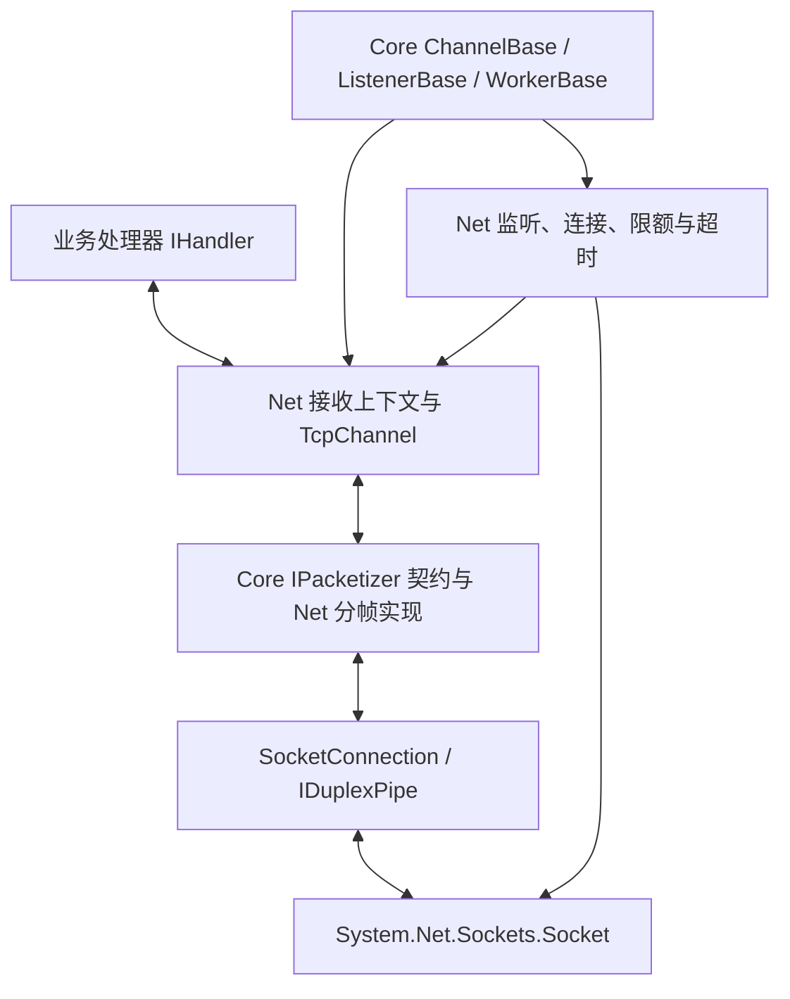

# Zongsoft.Net TCP 通信设计与实施计划

本文定义网络库的目标契约、实现边界、实施顺序与验收标准。主要负载为物联网设备、自动售货机和 POS 的长连接通信：高峰期间并发连接多、频繁交换中小消息，低峰期间大量连接仅间歇发送心跳。

## 1. 目标与约束

- 同时支持 `net8.0`、`net9.0`、`net10.0`，三个目标框架具有一致的公开契约与可观察行为。
- 使用 `Pipelines.Sockets.Unofficial` 的 `SocketConnection`，运行仅要求相应版本的 `Microsoft.NETCore.App`；应用携带需要的 NuGet 依赖，不依赖 `Microsoft.AspNetCore.App`。
- 优先保障请求响应的尾延迟、并发容量与空闲连接内存，再优化吞吐；以可复现测量确定取舍。
- 业务通过 `IChannel`、`ISender<T>`、`IHandler<T>` 开发。连接管理、编解码、缓冲所有权、取消和关闭由类库统一处理。
- 公共入口与核心流程保持集中，避免重复收发循环、重复状态机和按消息创建的中间队列。
- Core 中的公共契约与基础流程直接在 Core 中完善；TCP 参数和第三方实现细节由 Net 承担。
- API 按目标职责直接设计，所有受影响实现、消费者、示例与测试同步采用同一契约。
- 开发遵循 [C# 开发规范](../../guidelines/zongsoft.csharp.guidelines.md)、[规范检查说明](../README.zh-Hans.md#code-analysis)、[Net 工作约定](AGENTS.md)及 [Core 工作约定](../Zongsoft.Core/AGENTS.md)。

本计划覆盖 TCP 客户端、服务端、通道、分帧器及其依赖的 Core 能力。设备身份、命令关联、业务 ACK、重试幂等、支付逻辑和心跳报文格式属于协议或业务层。TLS、UDP、QUIC、多传输引擎和业务会话持久化另行设计。

## 2. 分层与代码归属



| 项目与区域 | 职责 |
| --- | --- |
| Core `Communication` | 通道生命周期、发送与处理契约、分帧与报文所有权契约 |
| Core `Components` | 工作器异步状态转换、处理器公共入口与无参数调用 |
| Net `TcpClient<T>` / `TcpServer<T>` | 连接与监听、运行配置、通道集合、服务级任务所有权 |
| Net `TcpChannelBase<T>` | 单连接接收、发送协调、限额、统计和完成状态 |
| Net 分帧器 | 长度前缀帧与原始字节块处理 |
| Net 内部传输实现 | Socket 配置、`SocketConnection.Create`、取消与传输资源收尾 |
| Net `test/Zongsoft.Net.Tests.csproj` | 单元测试、契约测试与真实 Socket 回归 |
| Net `benchmark/Zongsoft.Net.Benchmarks.csproj` | 性能测试、负载与内存测量 |
| Net `samples` | 可运行范例，按场景扩充现有 client、server 或创建相应范例项目 |

`IDuplexPipe` 是内部数据边界。业务 API 不暴露 `SocketConnection`、`SocketServer` 或第三方选项；第三方对象由单一内部所有者管理。监听使用官方 `Socket.AcceptAsync`，客户端使用官方 `Socket.ConnectAsync`，成功后统一交给 `SocketConnection.Create`。

客户端与服务端共用收发和关闭实现。`TcpClientChannel<T>`、`TcpServerChannel<T>` 仅承载所属对象及必要的生命周期关联。连接管理器仅管理连接，不承担 Socket 监听基类的职责。

## 3. Core 公共能力

### 3.1 通道关闭与释放

`IChannel` 保持通用生命周期职责；协议包、端点、Socket 和心跳配置不加入该接口。`ChannelBase` 统一管理以下语义：

1. 状态单向经过可用、关闭中、已关闭、释放中、已释放。关闭完成后不重新变成可用。
2. 第一次关闭取得执行权；并发关闭者等待同一个完成结果。释放同样只执行一次。
3. 不为每个通道创建内核等待事件。使用原子状态及必要的短临界区，关闭完成任务按需创建；不在锁内调用事件或执行异步 I/O。
4. 已取消的令牌在关闭开始前生效。关闭开始后，调用方取消只取消其等待，不终止资源收尾，也不取消其他调用者的等待。
5. `Closing`、`Closed` 各触发一次。事件、扩展点或 I/O 的异常不能跳过其余清理；异常通过完成结果及所属组件的错误边界观察。
6. 基类确保关闭与派生资源释放的顺序，派生类不在关闭前清空仍被关闭流程需要的字段。重复释放不重复触发扩展点或事件。
7. 同步事件不得阻塞等待同一通道的关闭；重入关闭请求不会再次执行关闭流程。测试分别覆盖重入请求与外部并发等待。

Net 区分两个完成边界：

- `CloseAsync`：停止接受新操作并关闭传输，允许从正在执行的业务处理器中等待调用。
- `Completion`：Net 所拥有的接收流程、当前处理器、发送操作和缓冲清理已经退场；外部 `DisposeAsync` 等待这一边界。

接收处理器内部可以调用 `CloseAsync`，不得等待包含自身的 `Completion` 或 `DisposeAsync`。接收流程的 `finally` 只完成自身拥有的资源及退出通知，不回头等待自身任务。关闭请求不能提前归还仍被异步处理器使用的内存。

### 3.2 工作器与监听器

在 `WorkerBase` 中统一完善异步启停和释放，不在 `TcpServer` 外围增加另一套启停锁：

- `StartAsync`、`StopAsync`、`PauseAsync`、`ResumeAsync` 的等待使用异步同步机制；状态转换相互协调，并在获得执行权后重新验证状态。
- 并发停止等待实际停止完成；启动失败、取消、绑定失败向调用方传播，不依赖是否附加调试器决定结果。
- 启动失败必须清理部分初始化资源；停止进入收尾阶段后完成清理，调用者取消等待不令服务重新接收连接。
- 增加一致的异步释放链。同步入口如仍有实际消费者，由 Core 集中定义其阻塞语义；Net 的正常工作及示例使用异步入口。
- 生命周期通知在状态确定后发出；通知失败不得恢复已经失效的运行资源或覆盖原始故障。

`ListenerBase<TArgument>` 专注于工作器与处理器派发，`TArgument` 表示处理器实参。字节解码和 `IPacketizer<TPackage>` 由实际流接收者持有，不要求监听器实参类型与线协议包类型相同，也不提供没有连接上下文的虚假接收能力。

`IListener<TArgument>` 明确异步释放能力。`IReceiver` 作为独立接收契约保留，由确实能够处理其输入的组件实现。未配置处理器时采用明确的空处理行为，仍执行取消检查与报文释放，不构造带未取消令牌的取消任务。注入的处理器由提供者拥有，监听器不自行释放共享处理器。

### 3.3 处理器调用

- `HandlerBase<TArgument>` 的无附加参数重载传递 `null`，与有返回值的处理器及非泛型桥接入口保持一致，不为每次消息创建空 `Parameters`。
- 显式传入的 `Parameters` 保留引用身份和数据，不替换为共享可变容器。
- TCP 热路径直接调用泛型 `IHandler<TArgument>`，不经 `object` 转换，不把上下文装入字典。
- 每个 `ValueTask` 恰好消费一次；同步成功路径也调用 `GetResult` 或使用等价的正确消费方式。需要多个等待者的生命周期操作使用可共享的 `Task`。
- 检查所有受影响处理器中对 `parameters` 的访问，按允许为空的契约修正调用链。

### 3.4 分帧与报文所有权

`IPacketizer<T>` 定义以下完整契约，并将同类语义同步到请求／响应形式的 `IPacketizer<TRequest, TResponse>`：

| 能力 | 目标语义 |
| --- | --- |
| `GetLength` | 在编码前返回精确的线协议字节数，包含包头；不改变报文状态、不分配完整编码副本 |
| `Pack` | 仅向 `IBufferWriter<byte>` 写入一帧，不负责 Flush；实际写入量必须等于声明长度 |
| `Unpack` | 数据不足时返回 `false` 且不消费输入；成功时消费至少一个字节；非法输入抛出明确的协议／数据异常 |
| `Release` | 释放本次成功解码产生的报文资源；默认无操作，由拥有资源的分帧器实现 |

解码端在处理器完成或失败后，于 `finally` 中调用一次 `Release`，然后推进输入。发送端不取得调用者传入报文的所有权。不能仅凭业务对象实现 `IDisposable` 就自行释放它，也不通过对可释放值类型装箱来推断所有权。

`GetLength` 与 `Pack` 期间报文必须稳定；发送完成前调用者不能修改或释放其底层内存。编码尺寸校验失败且已写入部分帧时终止连接，避免后续帧接续在损坏数据之后。

## 4. 上层开发模型

### 4.1 接收上下文

Net 提供 `TcpReceiveContext<T>` 只读值类型，包含当前 `TcpChannelBase<T>` 与 `Package`。它属于 TCP 业务接收模型，不加入 Core 的通用 `IHandler` 接口。

- 服务端使用 `ListenerBase<TcpReceiveContext<T>>`，客户端和服务端均接受 `IHandler<TcpReceiveContext<T>>`。
- 业务通过上下文中的通道回复当前设备，不查找远端地址、不借助广播完成单连接响应。
- 通道提供稳定连接标识、本地／远端端点、收发统计和异步发送；稳定标识区分同一远端地址的多次连接。
- 同一连接按接收顺序等待处理器；不同连接可并发调用同一个处理器，处理器需要满足这一并发契约。
- 默认不提供每包 `Task.Run` 或无限并发派发。需要后台处理时，由业务显式复制／取得报文所有权并实施有界调度。
- 上下文的复制不延长借用内存的寿命；报文借用范围截至本次处理器返回的异步操作完成。

### 4.2 创建与发送

- 创建方法返回独立的客户端或服务端实例，不共享可变的全局连接、地址和处理器。
- Headed 使用 `ReadOnlySequence<byte>` 表达消息正文；Headless 也使用借用的 `ReadOnlySequence<byte>` 表达当前可用的有界字节块。需要持有数据时显式使用现有缓冲复制／租约能力。
- `TcpChannelBase<T>` 实现 `ISender<T>`。字节便利重载仅由二进制协议入口提供，并汇入同一个分帧与发送流程，不出现有的重载带头、有的重载绕过分帧的行为。
- `SendAsync` 成功表示编码数据已提交本地发送流程，并通过本次 Flush 的背压等待；不表示对端收到或设备完成业务操作。
- 并发发送的帧不能交错；不承诺来自不同调用者的调用时刻构成严格排序。需要确定顺序的调用方顺序等待发送。
- 客户端实现 `IAsyncDisposable`，显式连接与首次发送惰性连接共用同一建连流程；不自动重放结果不确定的业务消息。

## 5. 传输、收发与资源边界

### 5.1 Socket 与 Pipe

- 服务端绑定明确配置的端点，使用与端点一致的地址族；端口为零时返回操作系统分配的实际端点。启动参数的解析在入口完成，不静默覆盖已设置的地址。
- `AcceptAsync` 不等待单个连接生命周期；每个成功接入的连接立即登记到服务级任务与连接管理中。
- 客户端的 DNS／连接尝试支持取消与连接超时。并发建连合并为一个在途操作；断开、释放或地址变更使过期建连结果不能发布。
- Socket 创建、连接、配置、传输包装、通道登记的每个失败分支都有唯一释放者。不得依赖 `ConcurrentDictionary.GetOrAdd` 的工厂只执行一次。
- 默认 `NoDelay = true`，开启 `ZeroLengthReads` 作为物联网负载的初始配置，并在基准中与关闭配置比较。
- 收发 Pipe 分别配置背压阈值，使用共享内存池及线程池调度，`useSynchronizationContext = false`。
- `InlineReads`、`InlineWrites` 和 `PipeScheduler.Inline` 不进入默认配置；任何调度优化均需证明不会把耗时业务阻塞放到 I/O 线程上。
- 不为每个连接预租大块接收缓冲，也不默认设置巨大的 Socket 收发缓冲。池容量、内核缓冲及托管对象内存分别测量。

### 5.2 接收与分帧

1. 每个通道仅有一个 `PipeReader` 使用者，负责 Read、拆帧、等待处理器、释放报文、Advance 和 Complete。
2. 准确维护 consumed 与 examined；不完整帧的已检查数据和已消费数据分别处理，异常与取消也完成本次读取的归还责任。
3. Headed 使用四字节大端无符号长度；先验证长度上限，再以受检运算计算总帧长度。空正文帧合法并消费四字节包头。
4. Headless 在输入为空时返回不足，在成功时消费实际产出的非空字节块；它不承诺 TCP 分段与业务消息一一对应。
5. 通道校验解包进度，成功却未消费输入视为分帧器错误，终止连接而不是重复处理。
6. 对残留未完成数据设置独立字节上限和组包期限。Pipe 暂停阈值是流控阈值，不是最大帧长度，也不是内存硬上限。
7. 批量收到多帧时逐帧处理，处理帧数达到检查批次后检查取消与关闭状态；只在测量证明需要时加入公平调度，避免每包主动让出线程。
8. 正常 EOF 前处理全部完整帧；EOF 后仍有残帧属于截断错误。正常半关闭允许完成已收到请求及其响应，然后进入有期限的发送排空和关闭。
9. 处理器故障默认终止当前连接，由连接所有者记录一次故障；正常取消、正常 EOF 和协议错误分别统计。

### 5.3 发送与背压

- 一次发送依次完成状态检查、尺寸测量、额度预留、单写者协调、完整帧编码和一次 Flush。未经额度许可不进入等待队列，也不创建编码副本。
- 同时限制在途发送操作数与未发送线协议字节数。额度不足时明确拒绝，由调用者执行等待或降载策略；类库内部不积累无界等待者。
- 字节预算覆盖等待编码、正在编码以及已进入发送 Pipe 但尚未完成 Socket 发送的数据。采用预留字节、累计提交字节与 `SocketConnection` 的公开发送完成计数核算；不能在 Flush 返回时提前释放全部字节额度。
- 尚未写入数据的取消返还预留额度；写入开始后的编码失败、取消或 Flush 故障使连接进入终止流程，不在同一连接继续发送下一帧。
- 对 `FlushResult.IsCanceled`、`IsCompleted` 和异常使用一致的失败语义。取消发生在写入后时，调用方不能据此推断远端没有收到数据。
- 使用受限的写入器验证编码长度与申请容量，防止自定义分帧器绕过额度；不反射读取 Pipe 私有字段作为正确性依据。
- 在无竞争且操作同步完成时直接返回完成的 `ValueTask`，不创建排队节点或额外状态对象。仅在确实需要等待时进入异步慢路径。
- 字节预算约束线协议数据；池分配粒度、空闲池保留和调用方业务对象图另行计量，不宣称它等于整个进程的物理内存上限。

### 5.4 连接集合、广播与关闭

- 按稳定连接标识登记连接，地址仅作为元数据。移除时核对实例或标识，避免已结束连接移除后来接入的连接。
- 连接数限额包含正在建立和已建立的受理资源；登记失败、取消、关闭和释放都恰好归还一次额度。
- 集合默认提供并发可枚举的实时视图，不在每次广播或计数时复制整个连接集合。广播不保证包含并发新加入的连接。
- 广播使用有界并发及每连接发送期限，不能为全部连接一次性创建任务数组；慢设备不能阻塞其余所有连接。
- 广播结果描述本地发送成功、失败及拒绝数量；调用者取消向上传播，不吞掉取消后返回正常成功结果。
- 停止顺序为停止接入、停止登记、等待接入循环退场、停止新发送、限时完成在途处理与排空发送、关闭 Socket、等待 Net 所拥有的任务及清理。
- 排空以 Socket 发送完成计数达到目标为依据，Flush 或 `PipeWriter.CompleteAsync` 本身不能作为远端交付或发送排空的证据；等待仅在关闭阶段执行，不忙等。
- 关闭期限到达后强制结束网络传输。对于不响应取消的业务处理器，保留其借用内存并记录仍在执行的任务；停止返回超时／失败，不能提前回收内存或报告全部完成。
- 正常 `StopAsync` 成功时监听 Socket、Net 接收任务、发送操作和连接登记均已结束；`DisposeAsync` 成功时所有由本组件拥有的资源均已收尾。再次启动建立独立的运行代次，不复用已取消令牌或已关闭 Pipe。
- 停止超时且仍有任务未结束时，组件保持停止中／故障状态并拒绝再次启动；只有实际清理完成后才可进入可启动的已停止状态。
- `SocketConnection` 内部循环由关闭 Socket 和正确完成 Pipe 两端驱动退出；不通过反射获取其私有任务。资源测试验证其句柄和租约能够退场。

## 6. 配置、时间与观测

采用 `TcpConnectionOptions`、`TcpServerOptions`、`TcpClientOptions` 表达共同连接设置及各自设置。入口验证数值与相互关系，启动／建连时形成内部快照；不允许外部修改选项对象影响已经运行的循环。

以下是实现和压测的初始值，性能阶段根据相同负载的测量统一定稿：

| 配置 | 初始值／规则 |
| --- | --- |
| `NoDelay` / `ZeroLengthReads` | 均为 `true` |
| 最大正文长度 | 64 KiB；包含包头的最大线协议长度单独计算 |
| 最大残留未完成接收数据 | 128 KiB，必须容纳最大合法完整帧 |
| 接收／发送 Pipe 暂停、恢复阈值 | 64 KiB / 32 KiB；阈值不代表预分配容量 |
| 最大在途发送操作数 | 每连接 64 |
| 最大未发送线协议字节数 | 每连接 256 KiB，至少容纳一帧最大合法报文 |
| 监听 backlog | 1024，实际生效值受操作系统限制 |
| 最大连接数 | 默认 10,000；部署按测得的单连接成本与容量要求明确配置 |
| 建连／发送／组包期限 | 10 秒 / 30 秒 / 30 秒 |
| 空闲期限 | 默认禁用，由设备协议设置，不根据中小包假定心跳间隔 |
| 停止期限 | 10 秒；到期触发强制网络关闭并报告尚未完成的任务 |
| 广播并发度 | 32；整体同时执行的广播也必须受到限制 |

时间和超时实现规则：

- 使用 `TimeProvider` 与单调时间戳计算间隔，支持测试控制时间；不用墙上时间比较超时。
- 共享维护循环负责连接空闲、未完成帧和发送进度期限，初始扫描周期一秒；按需启用，不为每个空闲连接创建周期计时器。
- 空闲时间以实际接收活动更新；组包期限自首个未完成帧字节开始，零星追加字节不无限延期。有效业务心跳的定义仍归协议层。
- 建连以及显式短期限等待使用对应异步 API；避免每次正常收发都创建关联 `CancellationTokenSource` 或 `Task.Delay`。
- 扫描采用有界批次和稳定游标，统计最坏检测偏差。单轮扫描超出目标周期时报告容量问题，不能靠提高扫描频率掩盖遍历成本。

观测包括活动连接、接入与拒绝、收发字节与帧、在途发送数与字节、超时、协议错误、关闭原因。计数采用原子增量并在连接结束后仍可汇总；默认不为每条心跳分配日志、标签字典或跟踪活动。指标标签不使用设备 ID、连接 ID 或远端端口等无界维度。

## 7. 多目标框架与性能技术

| 能力 | .NET 8 | .NET 9 / .NET 10 | 使用原则 |
| --- | --- | --- | --- |
| `Socket` 异步连接与受理、取消 | 使用官方异步 API | 相同公开流程 | 不以 `Task.Run` 包装同步 I/O |
| `Memory` / `Span` / `ReadOnlySequence` / `IBufferWriter` | 支持 | 支持 | 优先切片与直接编码，避免整包拼接副本 |
| Pipelines | 通过适用 NuGet 依赖提供 | 使用相应目标解析出的依赖／共享框架资产 | 检查实际还原结果及发布依赖，不增加 ASP.NET Core 引用 |
| `ValueTask`、`Interlocked`、`SemaphoreSlim.WaitAsync` | 支持 | 支持 | 热路径一次消费；共享生命周期结果使用 `Task` |
| `TimeProvider`、`PeriodicTimer` | 支持 | 支持 | 时间抽象与共享维护循环采用统一实现 |
| 短同步临界区 | 私有 `object` 与 `lock` | 可用 `System.Threading.Lock` | 以 `NET9_0_OR_GREATER` 分支声明准确字段类型，临界区不含 `await` |
| JIT、GC、Socket 运行时改进 | 由实际运行时提供 | 自动获得适用改进 | 不为运行时内部优化制造条件分支 |

条件编译局限于有真实 API 差异的小范围实现。新增 `NET10_0_OR_GREATER` 分支前，必须核实 API 的目标框架、说明收益，并为其他目标提供同语义实现。当前主流程无需依赖 .NET 10 独占 API。

默认不自建 SAEA 池、线程调度器、无锁队列、通用对象池或 `IValueTaskSource` 基础设施。只有分配或竞争测量确认热点后才引入，并覆盖复用、异常、取消与并发完成语义。报文切片减少托管复制，不宣称 TCP 全链路零复制。

## 8. 分步骤实施

各步骤完成代码、相关契约文档和本步验证后再进入下一步；下表勾选表示已满足本步验收，不表示仅完成编码。README、XML 文档和技能文件只描述当时实际提供的行为。

| 状态 | 步骤 | 主要产出 | 验收条件 |
| --- | --- | --- | --- |
| [ ] | P0 构建与测量基础 | 本地引用链、`benchmark/Zongsoft.Net.Benchmarks` 性能项目、负载程序骨架、回归清单及环境记录 | 性能项目纳入解决方案；单元测试保留在 `test/Zongsoft.Net.Tests`；三目标测试引用当前 Core，记录可运行路径的基线和阻断条件 |
| [ ] | P1 Core 生命周期 | `ChannelBase`、`WorkerBase`、`IListener` 的异步关闭、启停和释放 | 并发、重入、失败、取消及重复释放测试通过；直接派生实现通过定向验证 |
| [ ] | P2 Core 派发与分帧契约 | `HandlerBase`、`ListenerBase`、`IPacketizer` 的目标职责和语义 | 无参数调用无空容器分配；报文长度、消费与释放契约可验证；直接消费者可编译 |
| [ ] | P3 Net 传输与连接 | 选项快照、官方受理／建连、第三方传输包装、连接所有权 | 真实 Socket 连接、取消、端口占用、部分初始化失败、并发建连均可收尾 |
| [ ] | P4 通道与报文处理 | 共享接收／发送流程、上下文、两种分帧器、发送额度 | 分帧边界、响应路由、借用内存、并发发送、慢读与发送取消测试通过 |
| [ ] | P5 服务生命周期与容量控制 | 通道登记、广播、停止、超时维护、基础统计 | 高并发接入／关闭竞态、慢设备隔离、停止排空和超时行为通过 |
| [ ] | P6 业务示例与文档 | `samples` 中新增或扩充的范例项目，覆盖独立实例、当前通道回复、广播、长连接及双语指南 | 范例纳入解决方案，三目标编译及 loopback 冒烟通过，插件与依赖描述准确 |
| [ ] | P7 负载测量与参数定稿 | 微基准、三阶段负载报告、默认参数及必要条件分支 | 延迟、分配、内存、连接容量和回收结果达到下述验收要求 |

### P0：构建与基线

- Net 源项目使用对当前 Core 的 `ProjectReference`，测试和示例沿同一项目引用链解析 Core；Debug、Release 与基准不能混用历史 NuGet Core 或残留 HintPath 产物。
- 基准程序也引用同一工作区产物，记录提交／差异状态、SDK、运行时、操作系统、CPU、内存、GC 模式及依赖版本。
- 传输先固定 `Pipelines.Sockets.Unofficial 2.2.16`，与部署清单一致。升级依赖单独检查其已发布资产、变更和回归结果。
- 在 `Zongsoft.Net` 项目目录中创建 `benchmark` 子目录，并创建 `Zongsoft.Net.Benchmarks` 性能测试项目，项目文件为 `Zongsoft.Net/benchmark/Zongsoft.Net.Benchmarks.csproj`。项目包含聚焦性能测试与独立负载入口，覆盖三个 TFM；性能工具只成为测试依赖，不进入生产库。
- 单元测试项目保持为 `Zongsoft.Net/test/Zongsoft.Net.Tests.csproj`，功能与生命周期回归归入该项目，性能测量归入 `Zongsoft.Net.Benchmarks`。
- 将性能测试项目加入 `Zongsoft.Net.slnx`，提供运行入口、场景参数及结果说明；普通单元测试流程不自动执行长时间负载测试。
- 测量能够正确完成的 Headed 等路径；存在正确性阻断的路径先由契约测试明确，修正后建立基线，不将错误或丢包运行纳入性能比较。

### P1—P2：公共能力与直接消费者

- 核心文件包括 [ChannelBase](../Zongsoft.Core/src/Communication/ChannelBase.cs)、[WorkerBase](../Zongsoft.Core/src/Components/WorkerBase.cs)、[ListenerBase](../Zongsoft.Core/src/Communication/ListenerBase.cs)、[HandlerBase](../Zongsoft.Core/src/Components/HandlerBase%601.cs) 和 [IPacketizer](../Zongsoft.Core/src/Communication/IPacketizer.cs)。
- `ChannelBase` 的验证覆盖 Core 消息消费者、事件通道、事务事件通道、分布式缓存订阅，以及 ZeroMQ、Redis 的相关派生类；检查关闭前清空字段及处理器为空时跳过释放的路径。
- `WorkerBase` 的验证覆盖事件交换器、消息队列守护器、诊断工作器、ZeroMQ 服务、OPC 与 Hangfire 服务；`ListenerBase` 同时验证 MQTT 服务。
- `HandlerBase` 的派生类不限于通信目录，按整个仓库搜索直接派生与参数访问，修复允许为空后的实际调用问题。
- 涉及消息或外部适配器时先阅读其就近约定，仅修改受公共契约影响的实现。若涉及 Yuanshan，按仓库约定同步适配清单；路径或调用方不可访问时明确记录未完成的下游验证。
- 不通过增加测试可见性、跳过真实清理或吞异常来使测试通过。

### P3—P5：统一连接与收发

- 以 [TcpClient](src/TcpClient.cs)、[TcpServer](src/TcpServer.cs)、[TcpChannelBase](src/TcpChannelBase.cs)、[连接管理器](src/TcpServerChannelManager.cs) 和 [分帧器](src/Packetizer.cs) 为主要实现入口。
- 先打通单连接的建连、请求、回复和关闭，再加入并发发送、连接集合、广播及容量控制。
- 每个后台任务都有明确登记、故障观察及退出路径；构造函数不启动接收循环。
- 公开 `AcceptAsync` 如无业务消费需求收敛为内部接入过程；测试优先通过真实监听与公共 API 覆盖，不以保留额外公开入口换取测试便利。
- 各阶段保持当前目标契约可编译，不同时维护两套收发流程。

### P6：文档与产物

- 根据业务演示需要，在 `Zongsoft.Net/samples` 下创建相应的范例项目；优先扩充现有 `client` 和 `server`，独立场景确有必要时再新增子目录及项目。
- 范例按需演示请求响应、长连接心跳、自定义分帧、广播与取消关闭。新增或扩充的项目加入 `Zongsoft.Net.slnx`，在 samples 双语 README 中说明用途、运行方式、前置条件和退出清理。
- 客户端和服务端示例使用独立实例、`await using` 与取消令牌，处理器演示向当前通道回复；广播作为独立操作展示。
- 示例与库验证 `net8.0`、`net9.0`、`net10.0`；示例中的业务文本分配不进入传输层零额外分配的测量。
- 双语 README、样例 README、XML 文档、Net/Core 技能文件和资源文件与实际 API 同步；资源通过强类型生成器更新。
- 检查 `.csproj`、`.slnx`、`.deploy`、`.plugin` 及包依赖。TCP 由应用显式构造，文件系统插件只描述实际注册的 Web 文件系统。
- 说明发送完成、连接关闭、`Completion`、报文借用、取消后结果不确定和心跳期限的实际语义，不加入实施过程叙述。

## 9. 正确性验证矩阵

| 区域 | 必须覆盖的行为 |
| --- | --- |
| Core 生命周期 | 并发关闭／释放、重入请求、事件抛错、关闭抛错、取消等待、派生资源释放一次 |
| 工作器 | 并发启动与停止、启动失败可观察、停止等待实际结束、释放与启动竞争、通知异常 |
| 编解码 | 半个包头、跨段正文、多帧、空正文、超限长度、长度运算溢出、失败不消费、成功必须推进、EOF 残帧 |
| 资源所有权 | 同步／异步处理完成、处理异常、取消、关闭竞争时借用内存有效；每份已解码租约恰好释放一次 |
| 发送 | 多调用者无帧交错、长度声明不符、一次完整 Flush、计数与字节限额、慢读、取消各阶段、Flush 完成／取消标记 |
| 请求响应 | 两个以上客户端同时请求，响应只回到发起通道；处理器内等待关闭不死锁 |
| 客户端 | 建连失败、取消与超时、并发首次发送、断开／释放与建连竞争、失效结果不发布、无隐式业务重放 |
| 服务端 | IPv4／IPv6、动态端口、端口占用、突发接入、接入限额、停止期间受理竞争、相同地址的不同连接身份 |
| 广播 | 并发连接变化、慢设备隔离、有界任务数量、错误与拒绝计数、调用者取消 |
| 超时 | 真实空闲、慢心跳、未完成帧、持续少量字节、发送停滞、时间跳变与受控时间推进 |
| 停止 | EOF、半关闭、连接复位、排空、超时强制关闭、处理器不响应取消、成功后端口和任务退场 |
| 部署 | 三个目标框架均仅要求 `Microsoft.NETCore.App`；无 ASP.NET Core 传递共享框架依赖 |

测试使用受控完成信号、内存 Pipe、可控写入器与 loopback Socket；时间相关测试使用 `TimeProvider`。不以任意长的 `Task.Delay` 代替同步证据。异常断言验证类型、参数名和状态，不依赖本地化消息。测试验证公开行为，不镜像私有字段布局。

## 10. 性能验证与完成标准

### 10.1 负载组合

- 报文长度：0、32、128、512 字节及 1、4、16、64 KiB；覆盖单段和多段输入。
- 连接规模：1,000、10,000、50,000、100,000，按测试机器容量逐级增加；报告未达到的规模及限制，不能以模拟对象替代真实 Socket 容量。
- 阶段负载：连接爬升 → 高频请求响应 → 低峰心跳 → 再次高频 → 关闭。低峰心跳间隔覆盖 60—300 秒并加入随机抖动。
- 额外场景：集中重连、部分慢读／不读客户端、缓慢分片、广播与单连接响应并存、持续建立与断开。
- 比较三个运行时，分别比较 `ZeroLengthReads` 开关及经过论证的调度／阈值组合；其余负载和业务处理保持一致。

微基准用于分帧、泛型派发、同步发送快路径与分配；端到端程序用于网络延迟、CPU、连接内存与稳定性。客户端和服务端分进程，容量测试按需分机器或源 IP，避免客户端端口、CPU 或网络成为未识别的瓶颈。

### 10.2 指标与测量方法

- 报告完成消息数、吞吐、错误／拒绝／超时数与 P50、P95、P99、P99.9 延迟；延迟包含等待及排队时间，不能只统计成功且快速的请求。
- 同时提供请求响应闭环与固定到达率测量，说明直方图、采样方法和漏记排队时间的处理方式。
- 分别记录托管分配、GC 次数与暂停、托管堆、进程工作集／私有内存、句柄／文件描述符；不能用跨 `await` 的线程分配差值代表全流程分配。
- 按新增连接增量计算单连接成本，分别测量新建后空闲、收发后空闲和多轮突发后的稳定值。
- 峰值转低峰后的自然回收与强制 GC 诊断分开记录；内存池保留不直接判定为泄漏，但重复阶段不能持续无界增长。
- Release、无调试器、固定硬件和运行时，充分预热后至少三轮；保留原始结果及完整配置，不只保存平均数。

### 10.3 完成条件

- 三目标构建、相关单元测试与 loopback 生命周期测试全部通过；Windows 与 Linux 至少各完成一次真实 Socket 验证，未执行的平台不得标为通过。
- 默认无参数派发不分配 `Parameters`，借用式接收不复制完整正文，发送快路径无额外排队节点；对确需分配的业务负载和异步慢路径单独解释。
- 所有容量和字节限额在慢设备及竞争测试中成立，取消、异常和关闭后额度与租约正确归还。
- 高峰、低峰、再次高峰的重复测试中，任务、句柄、登记连接和租约无持续增长；低峰 CPU 与内存保留有可解释的来源。
- 在相同负载和容量条件下，候选优化不得以吞吐增加掩盖尾延迟或内存退化。以三轮离散程度确定噪声范围，超出噪声的退化必须解决或有明确的目标权衡依据。
- 硬件、目标连接数和端到端延迟 SLO 未确定前，不预先承诺绝对 QPS 或毫秒数；性能报告给出实际达到的容量、延迟及资源开销。
- 生产依赖、样例与文档准确，Core 直接消费者完成与变更范围相符的验证。

## 11. 执行检查

所有命令从仓库根目录执行。先核对当前测试运行器配置，再运行对应测试；首次构建先还原。P0 建立正确本地引用链后，以下命令用于逐目标验证：

```powershell
dotnet build Zongsoft.Core/src/Zongsoft.Core.csproj -c Debug -f net8.0 -p:GeneratePackageOnBuild=false
dotnet build Zongsoft.Net/src/Zongsoft.Net.csproj -c Debug -f net8.0 -p:GeneratePackageOnBuild=false
dotnet test Zongsoft.Core/test/Zongsoft.Core.Tests.csproj -c Debug -f net8.0 -p:GeneratePackageOnBuild=false
dotnet test Zongsoft.Net/test/Zongsoft.Net.Tests.csproj -c Debug -f net8.0 -p:GeneratePackageOnBuild=false
```

同组命令分别使用 `net9.0` 和 `net10.0` 执行；Core 早期步骤先运行相关测试，阶段验收运行受影响测试项目的完整测试。最后构建 Net 解决方案并验证样例，性能测量使用 Release 及同一工作区引用链。

- 保持严格代码规范检查，补充 `dotnet format style --verify-no-changes --diagnostics IDE0049`；需要时以 `--include` 限定实际修改文件。
- 格式检查保留只读模式；标准 formatter 的合法例外与已加载分析器的诊断一起核对，自动修改限于本次文件。
- 新文本采用 UTF-8 无 BOM、CRLF；C#、XML 与项目文件采用 Tab。保留已有文件换行和编码，不重排无关内容。
- 每步检查 `git diff --check`、未跟踪文件格式和文档链接；不为测量或测试扩大生产成员的可见性。
- 纯 Runtime 验证检查 `.runtimeconfig.json`、`.deps.json` 和实际运行；有条件时在只安装相应 .NET Runtime 的隔离环境验证。框架依赖检查与隔离环境验证分别记录。
- 实施和验证均不要求发布、推包、部署到业务环境或访问真实设备。

## 12. 技术依据

- [System.IO.Pipelines：缓冲、读取、背压与调度](https://learn.microsoft.com/en-us/dotnet/standard/io/pipelines)
- [Unofficial SocketConnection：连接与双向 Pipe](https://github.com/mgravell/Pipelines.Sockets.Unofficial/blob/551f244bb90364e137f58c79a260cb916a63192a/src/Pipelines.Sockets.Unofficial/SocketConnection.cs)
- [Unofficial 接收循环与 ZeroLengthReads](https://github.com/mgravell/Pipelines.Sockets.Unofficial/blob/551f244bb90364e137f58c79a260cb916a63192a/src/Pipelines.Sockets.Unofficial/SocketConnection.Receive.cs)
- [Unofficial 连接选项](https://github.com/mgravell/Pipelines.Sockets.Unofficial/blob/551f244bb90364e137f58c79a260cb916a63192a/src/Pipelines.Sockets.Unofficial/SocketConnection.Flags.cs)
- [System.Threading.Lock：适用范围与线程所有权](https://learn.microsoft.com/en-us/dotnet/api/system.threading.lock?view=net-9.0)
- [.NET 10 性能改进](https://devblogs.microsoft.com/dotnet/performance-improvements-in-net-10/)
