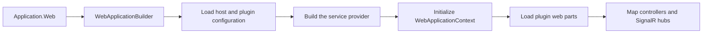

# Zongsoft.Plugins.Web Web Plugin Library


[English](README.md) |
[简体中文](README.zh-Hans.md)

-----

## Overview

[**Z**ongsoft.**P**lugins.**W**eb](https://github.com/Zongsoft/framework/tree/main/Zongsoft.Plugins.Web) connects the [Zongsoft plugin runtime](../Zongsoft.Plugins/README.md) to [ASP.NET Core](https://learn.microsoft.com/aspnet/core/). It creates a web host, initializes the plugin tree, discovers controllers and SignalR hubs contributed by plugins, and establishes a request-aware application context.

Use this package when a web application is assembled from Zongsoft plugins. Use [Zongsoft.Web](../Zongsoft.Web/README.md) directly when only its MVC, binding, formatting, authentication, or file-access helpers are required.

## How the Host Is Composed



The package deliberately owns this ordering. Plugin components must be available before MVC endpoints are mapped, while request-bound values such as `HttpContext`, the principal, and the session are resolved only while a request is active.

## Installation

```shell
dotnet add package Zongsoft.Plugins.Web
```

The package brings in `Zongsoft.Core`, `Zongsoft.Plugins`, and `Zongsoft.Web`. A deployable application normally also contains its plugin manifests and option files in the application directory.

## Quick Start

```csharp
using Zongsoft.Web;

var application = Application.Web(args, builder =>
{
	builder.Services.AddHttpContextAccessor();
});

await application.RunAsync();
```

Like daemon and terminal hosts, `Application.Web` first loads the application-named `.option`, also loads the entry-assembly-named `.option` when the names differ, and finally loads `web.option`. Missing files are optional; later configuration overrides earlier keys. It then builds the plugin-aware service provider, initializes `WebApplicationContext`, installs the framework middleware pipeline, maps controllers, and maps discovered SignalR hubs. The named overload sets the application name without excluding the entry assembly configuration.

> 💡 Keep application-specific service registration in the builder callback. Put reusable components and their relationships in plugin manifests so other hosts can compose them in the same way.

## Controller and Hub Discovery

The `ApplicationConvention` integrates plugin components with MVC application models. Controllers contributed by loaded plugin assemblies are activated through the framework service container. SignalR hub types are collected as application features and mapped during host startup.

The built-in `PluginController` exposes plugin information for framework tooling. Treat that endpoint as operational metadata and protect it according to the deployment's authorization policy.

## Real Use Case: The Discussions Web Plugin

### 1. Understand the Existing Controller's Consumption Boundary

[ForumController](../../discussions/src/api/Controllers/ForumController.cs) belongs to the real [Web class library](../../discussions/src/api/Zongsoft.Discussions.Web.csproj) and inherits the framework's service controller. This excerpt preserves one actual action and omits the others:

```csharp
[ControllerName("Forums")]
public class ForumController : ServiceController<Forum, ForumService>
{
	[ActionName("Moderators")]
	[HttpGet("{id}/[action]")]
	public IEnumerable<UserProfile> GetModerators(ushort id)
	{
		return this.DataService.GetModerators(id, this.Request.Headers.GetDataSchema());
	}
}
```

`Forum`, `UserProfile` and `ForumService` come from Discussions rather than types invented for this guide. The controller consumes its domain service through the base `DataService` property and passes the request schema. It constructs no data engine, database driver or cache implementation. See [ForumService.cs](../../discussions/src/Services/ForumService.cs).

### 2. Use Real Manifests and Deployment Artifacts

The manifest excerpt from [Zongsoft.Discussions.Web.plugin](../../discussions/src/api/Zongsoft.Discussions.Web.plugin):

```xml
<manifest>
	<dependencies>
		<dependency name="Zongsoft.Discussions" />
	</dependencies>
	<assemblies>
		<assembly name="Zongsoft.Discussions.Web" />
	</assemblies>
</manifest>
```

Use the [domain deployment manifest](../../discussions/src/Zongsoft.Discussions.deploy) and [Web deployment manifest](../../discussions/src/api/Zongsoft.Discussions.Web.deploy), preserving business options, mappings, identity extensions and templates. This package-composition fragment still requires the host, Data, Security, a database driver and file storage from the complete deployment plan:

```ini
[plugins zongsoft discussions]
nuget:Zongsoft.Discussions

[plugins zongsoft discussions web]
nuget:Zongsoft.Discussions.Web
```

The Web manifest depends on the domain plugin, whose project targets its public dependencies. Configuration and plugins locate data providers. See the [plugin guide](../Zongsoft.Plugins/README.md) for module composition.

### 3. Check Actual Requests and Prerequisites

[forum.http](../../discussions/docs/http/forum.http) contains maintained forum request templates, including the list route `/Discussions/Forums`. The moderator action appends `{id}/Moderators` to the base route; confirm the complete route through host controller descriptors.

Prepare a compatible host, dedicated initialized database, `Discussions` connection, test site, appropriate identity and required storage. Use forum identifiers from your test data rather than assuming a fixed ID exists. This is a source-backed use case, not a database-free probe or a promise of success in an uninitialized environment.

🚨 Do not remove identity transformation, data validators or business permissions to make an example succeed. Even read requests may expose forum data. Use an isolated identity/site and never copy repository addresses or credentials into real requests.

### Common Pitfalls

- DLL copied but controller absent: check manifest assembly entries, dependencies and the Web library's actual ASP.NET Core references.
- Controller discovered but HTTP 404: check `ControllerName`, module ownership, base routes and action templates; class names alone do not determine URLs.
- Service or data unavailable on first call: inspect service scanning, modules, connections, mappings and the database rather than hard-coding implementations into host startup.
- Subscription, worker and data-resource shutdown follow host lifecycle; stop the test host before cleaning only its test resources.

## Request Context

`WebApplicationContext` extends `PluginApplicationContext` with web-specific state:

- the current `HttpContext` and authenticated principal;
- the framework session abstraction;
- configured web sites and host mappings;
- initialization of web parts contributed by loaded plugins.

🚨 Do not retain request-scoped objects in singleton plugin components. `HttpContext`, principals, sessions, and scoped services are only valid for the active request and may be accessed concurrently by different requests.

## Listener Configuration and Request Ranges

`WebApplicationBuilder.Build()` loads plugin configuration, registers services and builds the host. `Application.Web()` loads the named host configuration followed by `web.option` before building, then composes the application pipeline. During the existing service scan, Plugins.Web's private `WebEndpointExtension.Registration` automatically enables endpoint conversion, request scopes and change monitoring when a Web host has entries under `Kestrel:Endpoints`. No change to the hosting program is required:

```csharp
var app = Zongsoft.Web.Application.Web(args);
await app.RunAsync();
```

The registrar uses the existing `IServiceRegistration` contract. It does not run for non-Web hosts, and skips hosts without endpoint entries or with an already registered `WebEndpointCollection`. Without declarations, native `urls`/`http_ports`/`https_ports`, `app.Urls` and code `Listen(...)` retain ASP.NET Core behavior. Detection uses the configuration available during service scanning; endpoint declarations added after startup require a restart. The zongsoft.tools.binding processing instruction declares exposure to deployment tools; runtime registration consumes endpoint configuration.

Automatic registration calls `AddWebEndpoints(configuration).AddWebEndpointMonitoring()`. These methods register factories and callbacks without creating a temporary provider or capturing a snapshot. The final provider creates the snapshot on first consumption, including protocol policies registered later in the service scan. Invalid declarations or plugin conflicts fail when resolving endpoint/server options or starting the host; do not rely on `Build()` throwing immediately.

```xml
<!-- web.option, explicitly imported web-default.option or a plugin entry -->
<options>
	<option path="Kestrel">
		<endpoints>
			<endpoint endpoint.name="api" url="http://127.0.0.1:8069/api" protocols="http1" />
		</endpoints>
	</option>
</options>
```

The extension calls the independent `KestrelUtility.Convert` to produce logical endpoints and separate configuration from the same input. Source URLs retain `/api`, physical URLs omit it, and logical scope remains `/api`. Certificates, SNI and other server options follow the [Web endpoint contract](../Zongsoft.Web/docs/endpoints.md). Both configuration and request scopes are startup snapshots; DI owns the projected configuration.

Different values for the same server key across plugins fail with the key and two entry paths, without values. Entry paths do not identify individual import fragments. Explicit imports within one plugin may override values; equal cross-plugin values are allowed. These checks belong to the endpoint extension, whether registered automatically or explicitly, and do not change generic plugin configuration rules.

Projection uses `PostConfigure` with reload disabled. Do not manually `Load()` the original path-bearing configuration beforehand. `ConfigureKestrel` callbacks run before post-configuration. Other `PostConfigure<KestrelServerOptions>` callbacks retain normal registration order: register them before this extension to avoid replacing its projection afterwards. The extension neither wraps listener factories nor prohibits native address sources. Kestrel controls additional listeners and duplicate binds; scope enforcement rejects requests that match no declaration. Empty collections are valid and reject all requests when enforcement is enabled. Actual HTTP/3 startup remains subject to platform and TLS requirements.

The extension calls `AddWebEndpointPipeline()` to register a private `IStartupFilter`, placing scope checks before application initializer middleware, automatic routing and static files. Do not call `UseWebEndpoints()` again. Custom startup-filter ordering remains the host's responsibility. Authentication and authorization retain their roles; controller and Hub routes do not gain prefixes automatically. Use KestrelUtility directly for conversion only. Non-plugin hosts can independently use Web endpoint registration and its startup-filter extension.

`AddWebEndpointMonitoring()` is included in automatic registration. For explicit registration it remains optional and must follow endpoint registration; repeated calls are harmless. It subscribes at host startup and unsubscribes on stop or disposal. Network changes or new plugin conflicts produce one `WebEndpointsChanged` warning without refreshing listeners or routes; business changes stay quiet. Without monitoring, snapshots still remain fixed but no restart warning is emitted. Initialization failure disposes the constructed host.

Explicit registration is available for a custom configuration section or for independent control of monitoring. Register it in the builder callback before service scanning. Automatic registration then preserves this choice, without adding another snapshot or monitor. The default section is `Kestrel`:

```csharp
using Zongsoft.Web.Hosting;

var app = Zongsoft.Web.Application.Web(args, builder =>
{
	builder.Services.AddWebEndpoints(builder.Configuration, "Server");
	// Optional for explicit registration.
	builder.Services.AddWebEndpointMonitoring();
});
```

## Startup and Extension Points

The generated pipeline enables CORS, localization, method override, routing, authentication, authorization, response compression, static files, controllers, and SignalR. `IApplicationInitializer<IApplicationBuilder>` implementations run before the standard middleware is added and are the supported hook for reusable startup behavior.

If middleware order is security-sensitive, inspect [Application.cs](src/Application.cs) before adding an initializer: authentication and authorization depend on routing, and endpoint mapping occurs after the standard middleware chain.

## Related Resources

- [Plugin runtime and manifest model](../Zongsoft.Plugins/README.md)
- [Web library](../Zongsoft.Web/README.md)
- [ASP.NET Core middleware](https://learn.microsoft.com/aspnet/core/fundamentals/middleware/)
- [Implementation guidance](../Zongsoft.Plugins/SKILL.md)
