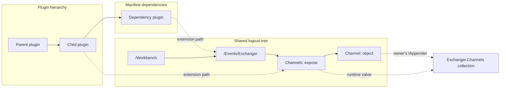
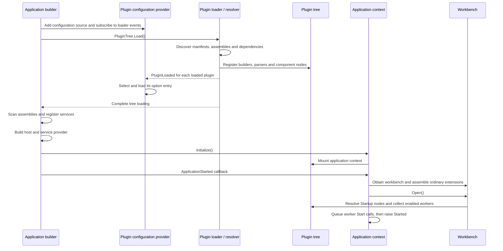
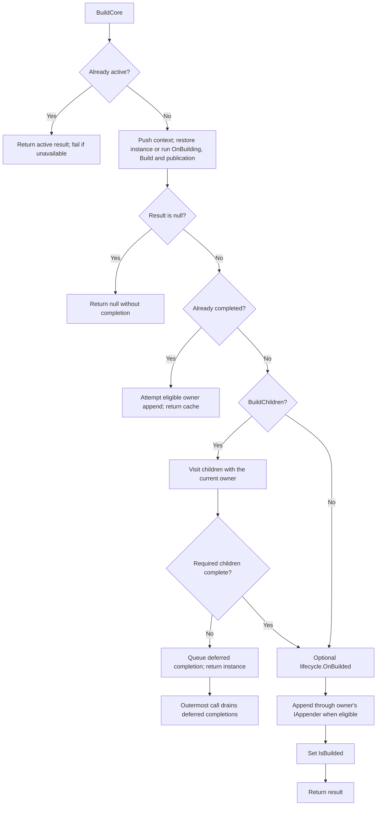
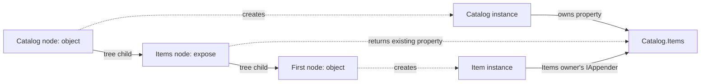
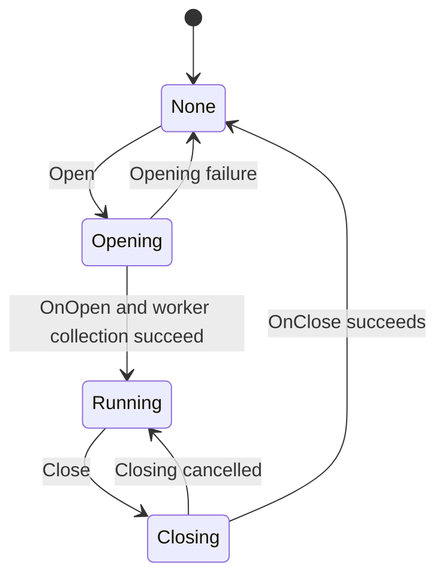

# Zongsoft.Plugins implementation

[简体中文](implementation.zh-Hans.md) · [Project overview](README.md)

This document describes the architecture and runtime behavior of Zongsoft.Plugins. It follows the implementation in this project; business plugins and the ASP.NET Core integration are separate consumers of these contracts.

- [1. Responsibilities and source map](#1-responsibilities-and-source-map)
- [2. The three relationships](#2-the-three-relationships)
- [3. Overall loading and startup flow](#3-overall-loading-and-startup-flow)
- [4. Discovery, dependencies and assemblies](#4-discovery,-dependencies-and-assemblies)
- [5. Manifest format and declaration model](#5-manifest-format-and-declaration-model)
- [6. Plugin tree, paths and values](#6-plugin-tree,-paths-and-values)
- [7. Builder and parser lookup](#7-builder-and-parser-lookup)
- [8. Construction and completion](#8-construction-and-completion)
- [9. Reflection construction and property assignment](#9-reflection-construction-and-property-assignment)
- [10. Owner appending and expose](#10-owner-appending-and-expose)
- [11. Expression parsing](#11-expression-parsing)
- [12. Dependency injection and module lookup](#12-dependency-injection-and-module-lookup)
- [13. Configuration entries and reloads](#13-configuration-entries-and-reloads)
- [14. Application context, workbench and workers](#14-application-context,-workbench-and-workers)
- [15. Unloading, destruction and ownership](#15-unloading,-destruction-and-ownership)
- [16. Extension contracts and diagnosis](#16-extension-contracts-and-diagnosis)

## 1. Responsibilities and source map

Zongsoft.Plugins turns plugin declarations into a shared logical tree, constructs objects on demand, assembles them into their owners, and connects the resulting application to configuration, dependency injection, and host lifecycle events.

The project targets the frameworks declared in [Directory.Build.props](../Directory.Build.props). Its infrastructure comes from Zongsoft.Core and Microsoft.Extensions.Hosting, Configuration, and DependencyInjection. [The project file](src/Zongsoft.Plugins.csproj) defines compilation and package contents; [the solution](Zongsoft.Plugins.slnx) includes the library and tests.

| Area | Main implementation | Responsibility |
| --- | --- | --- |
| Discovery and loading | [PluginLoader](src/PluginLoader.cs), [PluginResolver](src/PluginResolver.cs) | Discover files, read manifests, resolve dependencies, register declarations |
| Plugin metadata | [Plugin](src/Plugin.cs), [PluginDependency](src/PluginDependency.cs), [PluginOptions](src/PluginOptions.cs) | Parentage, assemblies, dependencies, foundations, paths |
| Logical tree | [PluginTree](src/PluginTree.cs), [PluginTreeNode](src/PluginTreeNode.cs) | Shared paths, mounting, lookup, value resolution |
| Component declarations | [Builtin](src/Builtin.cs), [BuiltinType](src/BuiltinType.cs), [PluginElementProperty](src/PluginElementProperty.cs) | Construction metadata, properties, cached values and completion state |
| Construction and assembly | [BuilderManager](src/Builders/BuilderManager.cs), [BuilderBase](src/Builders/BuilderBase.cs), [ObjectBuilder](src/Builders/ObjectBuilder.cs), [ExposeBuilder](src/Builders/ExposeBuilder.cs) | Coordinate construction, children, completion and owner appending |
| Expressions and reflection | [Parser](src/Parsers/Parser.cs), [ParserContext](src/Parsers/ParserContext.cs), [PluginUtility](src/PluginUtility.cs) | Expression dispatch, type resolution, constructors and member assignment |
| Configuration | [PluginConfigurationProvider](src/Configuration/PluginConfigurationProvider.cs) | Select option entries, aggregate plugin configuration, relay change notifications |
| Hosting | [ApplicationBuilder](src/Hosting/ApplicationBuilder.cs), [PluginApplicationContext](src/PluginApplicationContext.cs), [WorkbenchBase](src/WorkbenchBase.cs) | Register services, initialize the application, assemble the workbench and select workers |
| Diagnostics | [Commands](src/Commands), [Tests](test/README.md) | Inspect plugins and tree nodes; verify observable contracts |

The [Main manifest](plugins/Main.plugin) registers the standard builders and parsers and mounts common framework objects. The [Terminal manifest](plugins/Terminal.plugin) supplies terminal composition. These declarations are part of the runtime configuration, rather than registrations hardcoded into the XML reader.

## 2. The three relationships

A plugin system contains three related but independent structures.

| Structure | Defines | Does not determine by itself |
| --- | --- | --- |
| Filesystem plugin hierarchy | A plugin's `Parent` and `Children`, inherited foundation lookup | Where its components appear in the logical tree |
| Manifest dependency graph | Which plugins must be loaded first; access to declared foundations | Object ownership or automatic constructor injection |
| Logical plugin tree and object graph | Component paths, reference targets, owners and collection assembly | Filesystem layout or assembly isolation |

A manifest under one plugin directory can extend a path declared by another plugin. Several manifests can contribute children to the same path. An empty grouping node does not introduce a runtime owner; an `expose` node can introduce an owner by exposing an existing object or collection.



The XML nesting, logical path, and object ownership should therefore be examined separately when diagnosing an unexpected object or collection entry.

## 3. Overall loading and startup flow

The standard host integration installs the plugin configuration source before service registration loads the tree. Individual `PluginLoaded` notifications make option files available while loading proceeds. Assembly service registration runs after the entire tree has loaded.



These are distinct stages: loading declarations does not generally construct their business objects; construction does not start a worker; raising `Started` does not wait for every worker to finish starting.

## 4. Discovery, dependencies and assemblies

### 4.1 Options and tree identity

`PluginOptions` contains configuration, environment name, application directory, plugin directory and an extension-property dictionary. The normal plugin directory is `<ContentRoot>/plugins`. The explicit-directory constructor requires an existing rooted application directory; a blank directory uses `AppContext.BaseDirectory`.

`PluginTree.Get(options)` uses a process-wide concurrent cache. `PluginOptions` equality and hashing use only `PluginsPath`, with ordinary string equality. Different configuration objects or environment names do not create separate trees when that path string is equal. The cache has no public tree-disposal operation.

Default mount points are:

| Purpose | Default path | Override |
| --- | --- | --- |
| Application context | `/Workspace/Environment/ApplicationContext` | `Options.Properties["Mountion:ApplicationContext"]` |
| Workbench | `/Workbench` | `Options.Properties["Mountion:Workbench"]` |
| Startup | `<workbench path>/Startup` | Derived from the workbench path |

`Mountion` is the spelling used by the API.

### 4.2 Discovery and manifest loading

`PluginLoader` first discovers `*.plugin` files and reads manifest metadata. This phase also resolves declared assemblies. It then loads plugin content: builders, parsers and extensions.

For each directory, files are enumerated without an explicit filename sort. A non-hidden plugin with no declared dependencies is a master candidate. When a directory contains master candidates, its first enumerated master becomes the parent for plugins in descendant directories. A directory without a master passes its existing parent through to descendants. File ordering is therefore not a stable priority mechanism.

Plugin names are required and are unique, ignoring case, within their plugin collection. A hidden plugin is specifically a file named `.plugin`. It cannot declare dependencies and its content is processed after ordinary plugins and their descendants at that loading level.

Dependencies are located by a case-insensitive name search through the discovered plugin hierarchy, starting from the topmost collection. Resolution is not restricted to siblings. The loader recursively advances dependencies before the dependent plugin. Dependency graphs must be acyclic: this loader does not provide the construction manager's cycle detection for manifest dependencies.

The loader exposes `Loading`, `PluginLoading`, `PluginLoaded` and `Loaded` events. `Loaded` indicates successful completion. A content-loading exception is wrapped with plugin-file context and removes the failed plugin from its collection; it is not a rollback of every tree mutation already performed.

`PluginTree.Load()` loads only while its status is `None`. Loading sets `Loading` and successful completion sets `Loaded`. A failed load does not establish a general automatic retry contract.

### 4.3 Assembly loading

An assembly declaration first checks assemblies already present in `AssemblyLoadContext.Default` by simple name. Otherwise it loads the DLL relative to the plugin file. `optional="true"` permits a missing file; it does not suppress invalid-assembly errors.

The manifest creates an `AssemblyDependencyResolver` from the DLL matching the plugin filename when available, or from a loaded declared assembly. The tree's default-context resolving handler consults plugin resolvers and adjacent assembly files.

Assemblies use the default load context. Plugins share the process, loaded assembly identities and permissions. Plugin unloading does not unload these assemblies, provide independent dependency versions, or implement a security sandbox.

## 5. Manifest format and declaration model

[PluginResolver](src/PluginResolver.cs) reads XML with comments, processing instructions and insignificant whitespace ignored. Runtime XML reading uses `ValidationType.None`; [the XSD](Zongsoft.Plugins.xsd) is an authoring aid, not an automatically executed validation stage. Resolver behavior and loading tests establish the executable format.

The XSD allows zero or more extensions. The `manifest`, `builders` and `parsers` sections are each optional and may occur at most once. When present, `builders` must contain at least one `builder`, and `parsers` at least one `parser`. Sections follow the order `manifest` → `builders` → `parsers` → `extension`; omitted sections do not affect the order of the remaining sections. The schema declares `object`, `expose`, their constructor and property-behavior elements, nested components, unnamed typed parameters and parameter text. Builder/parser registrations require both `name` and `type`; required extension paths and known child structures remain validated.

Component attributes are open because their names depend on the target type. Child elements use `processContents="lax"`: known declarations are validated, while custom builders and member elements such as `QueueServer.Storages` remain extensible. Enabling .NET's `ReportValidationWarnings` can report missing schema information for these dynamic names; this is not a structural validation error. Additional schemas can declare custom builder elements using `BuiltinElementType`. Replacing the wildcard with `skip` would also stop checking known descendants.

XSD cannot establish whether a dynamic name is a registered builder or a valid member, whether a constructor matches its enclosing scheme/type, or whether expressions, assemblies and dependencies resolve. Those checks belong to loading and construction. The reader does not enforce the schema's section cardinality and order constraints. Its numeric version format is an authoring constraint; the reader also tolerates invalid versions by falling back. Processing instructions intended for development tools are not runtime plugin-loading hooks.

A declaration using the standard builders has this shape. The `Example.*` types below represent application types.

```xml
<plugin name="Example">
	<manifest>
		<assemblies>
			<assembly name="Example" />
		</assemblies>
		<dependencies>
			<dependency name="Main" />
		</dependencies>
	</manifest>
	<extension path="/Workbench">
		<object name="Catalog" type="Example.Catalog, Example">
			<expose name="Items" value="{path:../@Items}">
				<object name="First" type="Example.Item, Example" title="First item" />
			</expose>
		</object>
	</extension>
</plugin>
```

| XML construct | Runtime representation |
| --- | --- |
| `manifest/assemblies` | Assembly declarations and loaded assembly references |
| `manifest/dependencies` | Named `PluginDependency` entries |
| `builders/builder` | Named `BuilderElement` containing an implementation type |
| `parsers/parser` | Named `FixedElement<IParser>` containing an implementation type |
| `extension path="…"` | A target path in the shared plugin tree |
| A component element, such as `object` | A `Builtin` whose `Scheme` is the element name |
| `name` | Node name; an anonymous identifier is generated when omitted |
| `type` | `BuiltinType` and its constructor metadata |
| `position` | Sibling insertion hint |
| Other attributes | Deferred component properties |

The resolver distinguishes dotted elements from child components:

- `<object.constructor>` supplies constructor `parameter` elements with optional name, type and value. An explicit component type is required. Parameter text can supply the value.
- `<object.property name="…" target="…" value="…" />` records a `property` behavior, applied by `BuilderBase` during completion.
- Other `<scheme.behavior>` elements record named behaviors with attributes and text. They do not accept arbitrary nested XML.
- `<ComponentName.Property>` supplies a property value, including nested component declarations. Extended properties may also target a node from an extension.
- A nested component used as a property value is mounted under a generated `/Temporary/…` path and referenced from that property. It remains a component with its own construction lifecycle.

Properties retain raw values and parsing context. Loading an attribute containing `{path:…}` records an expression; evaluation occurs when its value is needed.

Sibling positions support `^` for the beginning, a sibling name for insertion before it, and `:Name` or `-Name` for insertion after it. An absent or unresolved position appends. This is a local insertion rule, not a topological ordering of object dependencies.

## 6. Plugin tree, paths and values

A `PluginTreeNode` has one of three kinds:

| Node kind | `node.Value` | `node.UnwrapValue(mode)` |
| --- | --- | --- |
| `Empty` | `null` | `null` |
| `Builtin` | The declaration object | The declaration's runtime value, using the requested obtain mode |
| `Custom` | An externally mounted object | That object |

A `Builtin` records its plugin, scheme, node, type, constructor, properties, behaviors and construction state. Its `Value` is a non-constructing cache read; `HasValue` means only that this cache is non-null. `IsBuilded` means the manager has completed the assembly required by that component's saved construction policy.

`Find` locates a node without constructing its value. `Resolve` and the path parser can unwrap it and then evaluate a member expression. `@` separates the node path from the member path, as in `/Workbench/Catalog@Items` or `../@Items`. Absolute paths, the current-node marker and a single parent step are useful common forms. The implementation of repeated parent navigation uses the original node's parent; do not assume arbitrary multi-step relative expressions behave like filesystem paths.

`GetOwnerNode` walks past empty ancestors to the nearest non-empty node. During child traversal, empty nodes preserve the current owner, while custom nodes replace it with their own value.

Mounting ensures the target path exists and sets its value. A declaration mounted on an existing path replaces that node's value while retaining its children. Public `Mount` accepts ordinary objects and rejects framework declaration/tree objects. Mounting raises `Mounting` and `Mounted`; it does not dispose the replaced value or replace references in already assembled owner collections.

`ValueType` uses a cached value's type, declared type, or builder inference. Type discovery can invoke parser type resolution; a parser's default implementation evaluates the expression. Type inspection is therefore not a universal guarantee of zero construction or side effects.

## 7. Builder and parser lookup

Builders and parsers are named foundations declared in plugins. Their implementation instances are constructed on first use and cached in their `FixedElement` wrappers.

For a name, `Plugin.GetBuilder` and `Plugin.GetParser` search:

1. The current plugin's own collection.
2. The collections of its direct declared dependencies.
3. Direct same-level dependent plugins returned by `GetSlaves(false)`.
4. The parent plugin, repeating the same lookup there.

The dependency step reads those plugins' collections; it is not a recursive lookup through every dependency's own lookup rules. For a tree node without plugin context, parser resolution can search non-hidden root plugins.

A component's element name selects its builder. An expression's scheme selects its parser. Registering a class in dependency injection alone does not register either alias.

## 8. Construction and completion

### 8.1 Contracts and state

[IBuilder](src/IBuilder.cs) provides `GetValueType`, `Build`, `DestroyAsync` and disposal. [IBuilderLifecycle](src/IBuilderLifecycle.cs) is an independent, optional interface with `OnBuilding` and `OnBuilded` callbacks. [IAppender](src/IAppender.cs) provides the owner's ability to receive a child object.

`BuilderBase` implements both `IBuilder` and `IBuilderLifecycle`. Its explicit lifecycle implementation dispatches to protected virtual methods; `OnBuilded` applies declared behaviors before invoking the derived hook. A builder can implement the lifecycle interface directly without inheriting this base class. The manager invokes the capability through the interface.

`OnBuilding` runs after reentrancy protection is established and before each actual `Build` invocation. `OnBuilded` runs for a non-null result after its required children are assembled and before owner appending. Neither callback replaces `Result`; decisions saved from `Build` govern assembly. Completed cache reads do not repeat callbacks. Instance-only module discovery can separate creation from completion, and the two callbacks need not receive the same context object. A failure before the completion stage, or a null result, prevents `OnBuilded` from running.

[BuilderContext](src/Builders/BuilderContext.cs) describes one construction operation: component, tree node, builder, depth, settings, owner and result. Reading `Owner` uses `Never` and does not construct the owner.

A concrete builder controls its operation inside `Build`:

| Context property | Meaning |
| --- | --- |
| `AppendToOwner` | Whether this result may be appended to its owner |
| `BuildChildren` | Whether the manager should automatically assemble children before completion |
| `Result` | The builder's returned object, assigned by the manager; externally read-only |

`AppendToOwner` initially permits appending. `BuildChildren` normally permits child traversal; its initial value also consults `Behaviors.GetBehaviorValue<bool>(Scheme + ".break")`. The builder can set either decision during `Build`. The manager saves both decisions with the returned instance and restores them when reusing it.

[BuilderSettings](src/Builders/BuilderSettings.cs) contains only `TargetType`, an inference hint. Child traversal creates child contexts without propagating the caller's settings.

### 8.2 Obtain modes

| Entry | Behavior |
| --- | --- |
| `GetValue(Auto)` | Rethrow a stored failure; return a completed cached value; otherwise create or finish assembly |
| `GetValue(Never)` | Return the cache, including null, an incomplete instance or an instance associated with a failure |
| `GetValue(Alway)` | Construct and update the cache without appending this result to its owner |
| `Builtin.Build(settings)` | Explicitly construct and assemble again, with normal owner-appending eligibility |
| Internal `GetInstance` | Obtain/create an instance for module discovery without child traversal or `OnBuilded` |

`Alway` is the enum's spelling. It does not dispose the old instance or replace the old reference in an owner collection. Its children still use normal child assembly. Neither force-construction entry recursively replaces every cached descendant.

An active construction is handled before another ordinary obtain or build is started: its available result is reused. If ordinary resolution needs that result before the builder has returned it, construction fails with a circular-construction error.

### 8.3 Assembly flow



The exact completion order is:

1. The optional `IBuilderLifecycle.OnBuilding` callback runs before actual creation.
2. `IBuilder.Build` returns an object.
3. The manager publishes `Result` and `Builtin.Value` and saves construction decisions.
4. Required children are assembled.
5. The optional `IBuilderLifecycle.OnBuilded` callback runs. `BuilderBase` applies behaviors before its protected `OnBuilded` hook.
6. The manager attempts owner appending.
7. `IsBuilded` becomes true and the result is returned.

A `ValueChanged` event can therefore observe a published instance before assembly is complete. Lifecycle callbacks do not replace the result. Reusing an already completed child during parent traversal can append it to that owner, but does not repeat child traversal or completion hooks. A direct `Auto` read of an already completed node simply returns its cache.

A null builder result receives no `OnBuilded` callback or owner append, and is not marked built. Child traversal treats that absence of an object as non-blocking for its parent.

### 8.4 Reentrancy, deferred completion and failures

The manager maintains an active context stack, a type-inference guard and a deferred-completion list, using component reference identity. `TryGetActiveContext` searches the active stack; a deferred component is not necessarily active.

A common property-reference sequence is: a collection-exposing child starts first, asks for its parent, and causes the parent to be created. The parent's traversal encounters the still-active child. The parent returns its published instance and defers completion. The child can then obtain the parent's collection, finish its own children, and return. Once the outermost call has unwound, the manager finishes the deferred parent. A deferred pass that cannot make progress reports circular construction.

This supports references to available instances. It cannot satisfy mutually dependent constructors whose instances do not yet exist. Type-inference cycles are guarded separately. Internal module discovery may return an active null result instead of forcing recursive construction.

If assembly throws after an instance has been published, the manager clears completion and stores the exception with `ExceptionDispatchInfo`. Later `Auto` access rethrows it instead of replaying partial side effects. A construction failure without a cached instance has no such cached failure guarantee. `Never` remains a cache inspection operation. Forced construction clears the stored failure for that attempt, but does not undo previous appends, event handlers or other side effects.

`BuilderManager.Current` uses one reentrant lock for construction and type access, including builder code and callbacks. It serializes these operations across trees. This does not serialize all plugin loading, configuration events or arbitrary object use.

## 9. Reflection construction and property assignment

`ObjectBuilder` selects the following path according to `value`:

- With a parseable `value`, it obtains the referenced/computed object and applies the remaining component properties to that object.
- With a literal `value`, it returns the literal raw value.
- Without `value`, it uses `PluginUtility.BuildBuiltin` to construct an instance and assign properties.

For reflection construction, an explicit `BuiltinType` takes priority. Without one, the utility attempts the owner's collection element type or default-member element type, then `BuilderSettings.TargetType`. Missing usable type information is an error. A declared type can also be interpreted through an owner's `IDiscriminator` before ordinary type-name resolution.

Type names use Core's type-alias parser and assembly resolution. Automatic constructor selection examines public constructors in descending parameter count and uses resolvable parameters. Explicit constructor declarations supply named or typed arguments and can combine them with injected parameters.

Parameter resolution understands the component name, plugin assembly/resources, `Builtin`, `PluginTreeNode`, `Plugin`, `PluginTree`, application context, application module and service provider. It also consumes matching component properties and services. Constructor selection follows these resolution rules, rather than implementing C# overload resolution.

After reflection construction, `ServiceInjector` injects services. Component property assignment then evaluates member expressions, obtains the target member type and converter, evaluates the property, converts where possible and writes the value. Builtin properties are enumerated before node-level extended properties, allowing later assignments to target the same member.

`PluginElementProperty.Value` caches its evaluated value. Changing `RawValue` invalidates that property's cache; typed `GetValue` can evaluate with an explicit requested type. Configuration notifications do not automatically invalidate all component property caches or reassign existing objects.

Property-assignment failures carry component/member context. Constructors and property setters run during object creation, before the manager publishes the builder's result; references requiring that same not-yet-published object cannot be satisfied at that point.

## 10. Owner appending and expose

### 10.1 Selecting the appender

The manager appends a child only when:

1. The owner object exists.
2. The owner node is a `Builtin`.
3. The child's saved `AppendToOwner` decision permits it.
4. The owner component's builder implements `IAppender`.
5. That appender accepts the child.

A custom-mounted owner has no builtin builder, so the manager does not borrow the child's builder to append into it.

Successful appending records the owner and result references on the child declaration. Revisiting that node with the same recorded pair does not append again. This is per-component tracking of its last successful pair, not collection-wide deduplication: two different declarations can still expose or append the same object.

`Append` returning false does not by itself make component construction fail. No successful append record is saved in that case.

### 10.2 ObjectBuilder appending

`ObjectBuilder` implements `IAppender` and attempts these receiver shapes:

| Receiver | Handling |
| --- | --- |
| `IDiscriminator` | Select a receiver and continue appending there |
| Generic dictionary with string/object keys | Use the child's name as key and convert its value |
| Generic `ICollection<T>` | Convert/add the value, or add compatible enumerable elements |
| Writable non-generic `IDictionary` | Add by child name |
| Writable non-generic `IList` | Add the child |
| Default member | Use the member selected by `DefaultMemberAttribute` or `DefaultPropertyAttribute` as the receiver |
| Public `Add` / `Register` method | Invoke a compatible one-argument method or a name-plus-value method |

### 10.3 Exposing a property

`ExposeBuilder` inherits object creation and receiver support from `ObjectBuilder`. During `Build` it sets `AppendToOwner = false`. Its result is available at its tree path, and its children can be assembled into that result.

In the catalog example:



The `Items` collection itself is created by `Catalog`, typically in its constructor or property initializer. The expose expression returns that collection; it does not assign the `Catalog.Items` property. The `First` object is created by its own builder and added by the builder of the `Items` node. The collection is not appended back to `Catalog`.

An expose declaration with `type` can also construct a standalone object and publish it without owner appending. Expose therefore describes participation in assembly, not a requirement that every exposed value be a preexisting property.

### 10.4 Event transport composition

The [ZeroMQ manifest](../messaging/zero/src/Zongsoft.Messaging.ZeroMQ.plugin) provides a concrete example:

| Path | Declaration | Role |
| --- | --- | --- |
| `/Workbench/Events/Exchanger/Channels` | `expose` from Main | Expose `EventExchanger.Channels` |
| `…/Channels/ZeroMQ` | `object` | Construct `ZeroQueueEventChannel` and append it to Channels |
| `…/Channels/ZeroMQ/Filtering` | `expose` | Expose the channel's filtering instance for extensions |

Early references to the channel or filtering node reuse the constructed instance. The channel component is appended to the exposed collection; the filtering expose is not appended to the channel. The exchanger's dispatcher handles ambient deferral, while the channel handles transport. Application plugins can use `object.property` to assign an `IFeaturePipeline<EventContext>` to `EventDispatcher.Pipeline`, then assign that dispatcher to the exchanger's `Dispatcher` property. The pipeline runs only after ambient conditions allow execution and wraps actual delivery.

## 11. Expression parsing

An expression has the form `{scheme:text}`. The parser dispatcher selects the named parser in the plugin context and supplies the component/node, target member type and expression text through `ParserContext`.

A standalone expression preserves the returned object. A recognized expression surrounded by text is formatted into a string. This mechanism is not a general recursive, multi-expression template engine.

[Main.plugin](plugins/Main.plugin) registers:

| Scheme | Implementation and result |
| --- | --- |
| `path` | [PluginPathParser](src/Parsers/PluginPathParser.cs): tree value and optional member access |
| `type` | [TypeParser](src/Parsers/TypeParser.cs): a resolved `Type` |
| `object` | [ObjectParser](src/Parsers/ObjectParser.cs): an instance constructed from a type expression |
| `static` | [StaticParser](src/Parsers/StaticParser.cs): public static field/property, with optional member navigation |
| `option` | [OptionParser](src/Configuration/OptionParser.cs): configuration binding using the target member type |
| `service` | [ServicesParser](src/Services/ServicesParser.cs): container or service resolution |
| `resource` | [ResourceParser](src/Resources/ResourceParser.cs): resource lookup and optional formatting |
| `command` | [CommandParser](src/Components/CommandParser.cs): a command delegate for later execution |

The path parser accepts an obtain-mode suffix, such as `{path:/Workbench/Catalog,Never}`, and uses `Auto` by default. `~` identifies the plugin file and `~/` its directory. Member resolution uses `@`, not a slash between the object and its CLR member.

Resource lookup searches plugin assemblies, dependencies and ancestors, with framework/entry-assembly fallbacks. Resource base names include the assembly name and conventional `Resources` / `Properties.Resources` names. A missing resource returns the input resource text.

A command expression creates a delegate that calls `CommandExecutor.Default.ExecuteAsync` when invoked; parsing does not execute it.

## 12. Dependency injection and module lookup

The host registration pass uses one assembly set for loaded entry references, the entry assembly and loaded plugin manifest assemblies. Each assembly is registered once per pass through Core's service-registration infrastructure. Registration code can read configuration from loaded descendant plugins.

Direct children of `/Workspace/Environment/Services` are registered as singleton service factories using each node's inferred value type and `UnwrapValue(Auto)`. Type inference can therefore occur before a service factory executes.

There are two distinct context-selection mechanisms:

| Mechanism | Context selection |
| --- | --- |
| Constructor/property service injection through `PluginUtility` | Find an application module along the owning tree context, otherwise use application services |
| `{service:…}` parser | Explicit module after `@`, explicit application container with an empty suffix, or a module named after the immediate parent node |

Module discovery can use the manager's instance-only path. Actual creation invokes `OnBuilding` and publishes the module instance without assembling its children, appending it, or invoking `OnBuilded`. A later `Auto` access can complete assembly and invoke `OnBuilded` without repeating `OnBuilding`.

Service-expression examples:

| Expression | Meaning |
| --- | --- |
| `{service:@}` | Application service provider |
| `{service:@Orders}` | The registered Orders module's service provider |
| `{service:~@Orders}` | A service matching the target member type in Orders |
| `{service:*@Orders}` | Services requested using the target member type in Orders |
| `{service:Repository@Orders}` | A named/aliased service in Orders |
| `{service:~}` | A type-based service using the immediate-parent module lookup, with application fallback |

An explicit unknown module returns null. The `~` and `*` forms need a target member type; when that type is a service-provider type, the provider itself is returned. Named lookup first uses `Resolve(name)`, then a target-type-aware `Find` when applicable, followed by the named-member fallback.

Core's provider-based `Locate<T>("name@provider")` syntax selects an instance provider. It is a different contract from the service parser's module suffix, even though both contain `@`.

## 13. Configuration entries and reloads

### 13.1 Selecting one entry per plugin

For each loaded plugin, `PluginConfigurationProvider` selects one file:

1. Change the plugin filename extension to `.option`.
2. Only if that file is absent, try `<plugin name>.option` in the same directory.
3. If neither exists, create no provider.

For `Feature-daemon.plugin` with plugin name `Feature.Daemon`, the first candidate is `Feature-daemon.option` and the fallback is `Feature.Daemon.option`. An existing but invalid first file raises an error; it does not trigger fallback.

The provider does not scan environment, site, host or suffix variants. Additional fragments belong to the selected entry's explicit XML imports. Core's XML provider implements imports and file watching; the plugin provider aggregates its values and notifications.

An import such as `<?import path="fragment.option" required="false"?>` resolves relative to its declaring file. Later imports can override earlier keys. An optional import permits a missing file, not invalid XML. Scalar configuration uses XML attributes; text nodes represent collection items.

Host `LoadConfiguration(name)` similarly loads `name.option`. Without a name, the host loads the application-name entry and then the entry-assembly-name entry if different. Deployment selectors and runtime configuration values do not change the plugin option-entry selection algorithm.

### 13.2 Aggregation and notifications

The provider subscribes to plugin load/unload events. Each entry is wrapped by an option provider containing a composite provider and a reloadable XML provider. Explicit `Load()` clears existing entry providers and rebuilds them for all loaded plugins, including descendants. Failure clears the providers established by that load.

`TryGet` returns the first matching provider encountered in the concurrent dictionary. No deterministic precedence is promised for conflicting keys across plugins. `Set` updates providers that already own the key. Child keys are aggregated and sorted.

Entry changes, imported-file changes, plugin loading/unloading and explicit reloads propagate renewable change tokens to the host. Replacement and disposal detach old subscriptions. `Providers` exposes per-plugin composite providers for consumers that need to inspect values and their plugin source.

File provenance identifies the entry file. It does not track which imported file contributed each individual effective key. Domain rules, such as conflicts between network endpoint declarations, belong to their consuming host subsystem.

The provider locks publication/clearing of entry providers and coordinates disposal; it does not hold a global lock across an entire load, every tree operation and all change callbacks. Callers should serialize explicit lifecycle operations. Notifications are not cross-file transactions and do not reconstruct objects, open new network listeners or replace loaded assemblies.

## 14. Application context, workbench and workers

After loading the complete plugin configuration, the host scans loaded entry references, the entry assembly and plugin manifest assemblies using one shared deduplication set. Registrars see the final plugin configuration, and each assembly is registered once per host build. Core's `FeatureProvider.Default` includes the transaction provider by default. Application services registered as `IFeatureProvider` add ambient conditions; the default feature provider combines sources and deduplicates them by reference on each capture.

`Application.DaemonAsync` and `Application.TerminalAsync` build on Microsoft hosting, register their plugin-aware application contexts, load configuration, build the host and initialize the context. [ApplicationExtension](src/Hosting/ApplicationExtension.cs) supplies the host initialization bridge. ASP.NET Core integration is implemented in [Zongsoft.Plugins.Web](../Zongsoft.Plugins.Web/README.md).

`PluginApplicationContext.Initialize` runs base initialization, ensures the tree is loaded and mounts the application context. The `Workbench` property constructs or resolves the workbench on first access, mounts the resulting object, visits ordinary workbench extensions and raises `WorkbenchCreated`.

Workbench traversal skips the configured Startup subtree. For an unfinished builtin it calls `Builtin.Build()`, then recursively visits child nodes. This traversal is separate from the manager's child traversal: `BuildChildren = false` governs a particular manager operation and does not forbid later explicit access or host traversal. References from other nodes can also trigger construction before the normal Startup visit.

`WorkbenchBase` implements these lifecycle states:



Opening raises the opening event, mounts the workbench when needed, invokes `OnOpen` and raises `Opened`. The default `OnOpen` resolves Startup nodes and registers every `IWorker`; `Enabled` selects startup, but does not exclude a registered worker from shutdown.

The context implements `IHostedLifecycleService`. Its `StartedAsync` phase opens the workbench and awaits enabled workers' concurrent `StartAsync` operations before raising the application's `Started` event. A startup failure cancels the remaining startup operations, waits for them to settle, and stops registered workers. Startup and cleanup failures are preserved together. Workers coordinate their own dependencies; manifest order does not order concurrent startup.

The terminal workbench owns its executor's `RunAsync` task. Completion sets the exit code and requests host shutdown through `Exit`; shutdown cancels and awaits the input loop. The executor must return asynchronously and honor cancellation for host startup and shutdown to remain unblocked. The built-in console executor still reads through synchronous `ReadLine`, so its input cancellation is outside this guarantee.

`Exit()` / `Exit(exitCode)` sets the exit code and calls `IHostApplicationLifetime.StopApplication()`. It does not wait for shutdown or call `Environment.Exit`. `StopAsync` awaits registered workers before closing the workbench, continuing after individual failures. Cancelling the host's wait does not cancel owned cleanup; final `DisposeAsync` still awaits it. `Workbench.Close` changes workbench state and raises its events. A caller that also wants application shutdown explicitly requests `Exit`.

The context supports asynchronous disposal only: actual worker shutdown precedes plugin resources, then context-owned initializers and modules. Container-resolved initializers, borrowed references and container-owned services retain their original owner. `BuildAsync`, `DaemonAsync`, `TerminalAsync` and `WebAsync` await disposal of a constructed host when initialization fails, preserving initialization and cleanup errors. When managing a host manually, await `StopAsync` before asynchronous disposal; `RunAsync` owns the standard shutdown flow.

## 15. Unloading, destruction and ownership

| Operation | Effect |
| --- | --- |
| `PluginTree.Unmount(node/path)` | Read and detach the cached value and return it, without taking disposal ownership |
| `PluginTree.UnloadAsync(plugin)` | Process cancellation, await descendants and dependents, destroy components and instantiated foundations |
| `PluginTree.UnloadAsync()` | Unload all plugins |
| `PluginTree.DisposeAsync()` | Await pending unloads, release all plugins, detach assembly resolution and evict the cached tree; ignore unload-event cancellation |
| `IBuilder.DestroyAsync` | Await disposal under the builder's ownership contract and clear construction state |

`BuilderContext.OwnsResult` defaults to true. Standard `object` and `expose` declarations own instances created through `type`; `value` expressions return borrowed objects. Appending and disposal ownership are independent decisions. The host container takes ownership of a component service on first resolution. A custom builder returning a shared object should set `OwnsResult = false`.

Default destruction prefers `IAsyncDisposable.DisposeAsync`, falling back to `IDisposable.Dispose`. Collections without either interface release members that have no independent component owner. An unload operation deduplicates by reference; collection traversal does not dispose borrowed component values. Concurrent destruction shares one completion task, reconstruction during destruction is rejected, and cleanup callbacks cannot await their own destruction or tree unload.

Unload visits child nodes, descendants and dependents first using snapshots. A disposal failure does not skip remaining resources; cleanup errors are reported together. Cancellation only ends the caller's wait, while final disposal awaits actual cleanup. Unused builders and parsers are not instantiated for disposal.

Unloading is not an atomic object-graph transaction. Appending has no general inverse: other collection references and application event subscriptions remain their owners' responsibility. Assemblies stay in the default load context; cache eviction does not provide assembly hot replacement.

## 16. Extension contracts and diagnosis

Custom builders register an alias in `builders`, return their result from `Build` and set operation-specific decisions there. Builders that receive children implement `IAppender` for their own target object. Builders can implement `IBuilderLifecycle` or override `BuilderBase.OnBuilding` / `OnBuilded` for stage callbacks, and customize destruction to match ownership requirements. Custom parsers register an alias in `parsers`, implement parsing, and provide type discovery when callers need it.

The standard diagnostic commands under `/Workbench/Executor/Commands/Plugin` are `Find`, `List` and `Tree`. Inspecting a declaration, reading a cache and resolving an object are different operations; choose an obtain mode deliberately when diagnosing construction.

| Symptom | Inspect first |
| --- | --- |
| Plugin absent | Discovery directory, plugin name, dependency availability, loader/file exception |
| Builder/parser absent | Alias and foundation lookup scope, Main manifest availability |
| Unknown component type | Explicit type, loaded assembly, owner element type, requested type hint |
| Missing collection member | Actual owner node/value, child's saved append decision, owner's appender and acceptance |
| Repeated collection member | Separate declarations of one object, explicit reconstruction, application-level additions |
| Circular construction | Active node path, constructor/property references before publication, type-inference references |
| Repeated failure on `Auto` | Published partial instance and stored failure; inspect without replay using `Never` |
| Option not found | Selected entry file, imported effective keys, target member type and configuration binding |
| Worker exists but has not started | Startup placement, `Enabled`, workbench opening and asynchronous start scheduling |

[Test documentation](test/README.md) maps loading, builders, expressions, configuration, services, workbench lifecycle and unloading to focused tests. These contracts concern the framework's assembly behavior; a plugin's own subscriptions, external connections and domain initialization remain the responsibility of that plugin.

