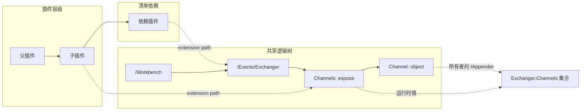
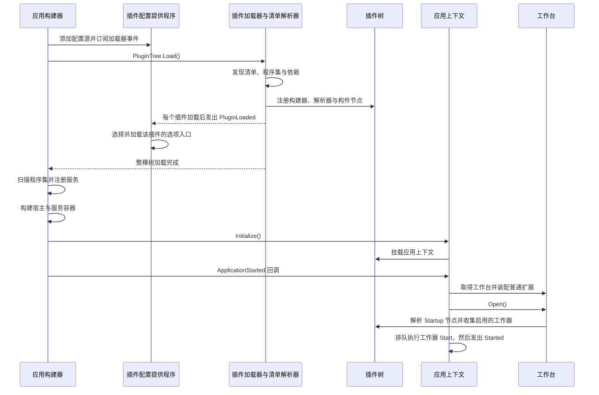
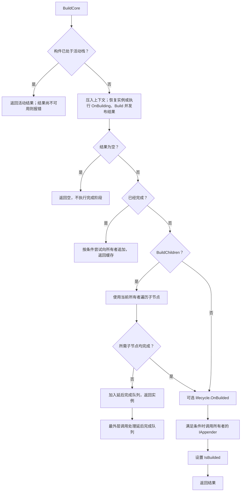
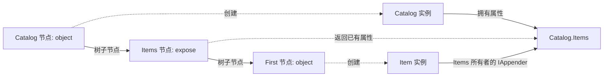
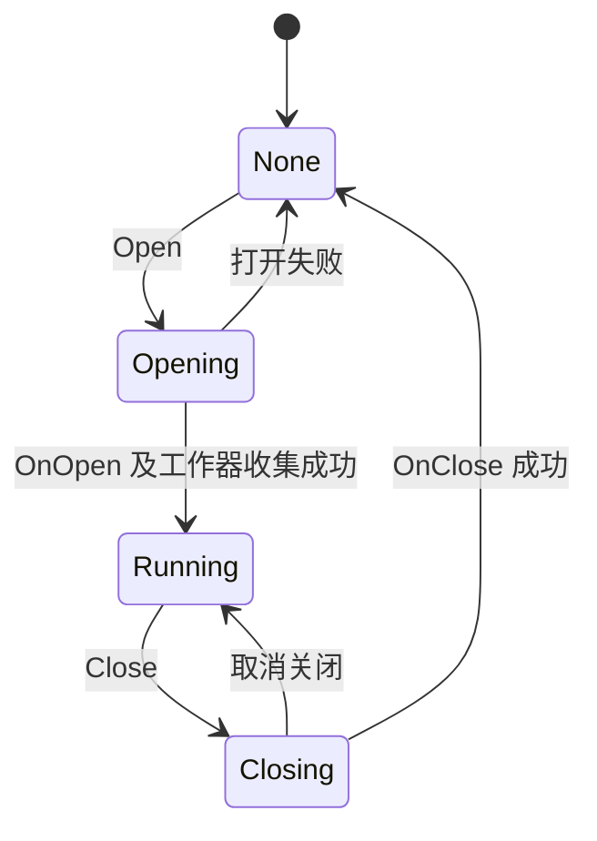

# Zongsoft.Plugins 实现原理

[English](implementation.md) · [项目概览](README.zh-Hans.md)

本文描述 Zongsoft.Plugins 的设计架构和运行行为，以本项目的实现为依据。业务插件和 ASP.NET Core 集成分别消费这些契约，其自身实现不属于本项目。

- [1. 职责与源码地图](#1-职责与源码地图)
- [2. 三种关系](#2-三种关系)
- [3. 加载与启动总流程](#3-加载与启动总流程)
- [4. 发现、依赖与程序集](#4-发现、依赖与程序集)
- [5. 清单格式与声明模型](#5-清单格式与声明模型)
- [6. 插件树、路径与节点值](#6-插件树、路径与节点值)
- [7. 构建器与解析器查找](#7-构建器与解析器查找)
- [8. 构建与完成](#8-构建与完成)
- [9. 反射构造与属性赋值](#9-反射构造与属性赋值)
- [10. 所有者追加与 expose](#10-所有者追加与-expose)
- [11. 表达式解析](#11-表达式解析)
- [12. 依赖注入与模块定位](#12-依赖注入与模块定位)
- [13. 配置入口与重载](#13-配置入口与重载)
- [14. 应用上下文、工作台与工作器](#14-应用上下文、工作台与工作器)
- [15. 卸载、销毁与所有权](#15-卸载、销毁与所有权)
- [16. 扩展契约与诊断](#16-扩展契约与诊断)

## 1. 职责与源码地图

Zongsoft.Plugins 将插件声明组织为共享的逻辑树，按需构建对象，将对象装配到其所有者，并与配置、依赖注入和宿主生命周期衔接。

项目的目标框架由 [Directory.Build.props](../Directory.Build.props) 定义，基础能力来自 Zongsoft.Core 以及 Microsoft.Extensions.Hosting、Configuration 和 DependencyInjection。[项目文件](src/Zongsoft.Plugins.csproj) 定义编译与包内容，[解决方案](Zongsoft.Plugins.slnx) 包含类库和测试。

| 领域 | 主要实现 | 职责 |
| --- | --- | --- |
| 发现与加载 | [PluginLoader](src/PluginLoader.cs)、[PluginResolver](src/PluginResolver.cs) | 发现文件、读取清单、解析依赖、注册声明 |
| 插件元数据 | [Plugin](src/Plugin.cs)、[PluginDependency](src/PluginDependency.cs)、[PluginOptions](src/PluginOptions.cs) | 父子关系、程序集、依赖、基础元素与路径 |
| 逻辑树 | [PluginTree](src/PluginTree.cs)、[PluginTreeNode](src/PluginTreeNode.cs) | 共享路径、挂载、查找、值解析 |
| 构件声明 | [Builtin](src/Builtin.cs)、[BuiltinType](src/BuiltinType.cs)、[PluginElementProperty](src/PluginElementProperty.cs) | 构造元数据、属性、缓存值与完成状态 |
| 构建与装配 | [BuilderManager](src/Builders/BuilderManager.cs)、[BuilderBase](src/Builders/BuilderBase.cs)、[ObjectBuilder](src/Builders/ObjectBuilder.cs)、[ExposeBuilder](src/Builders/ExposeBuilder.cs) | 协调创建、子节点、完成阶段与向所有者追加 |
| 表达式与反射 | [Parser](src/Parsers/Parser.cs)、[ParserContext](src/Parsers/ParserContext.cs)、[PluginUtility](src/PluginUtility.cs) | 表达式分派、类型解析、构造函数与成员赋值 |
| 配置 | [PluginConfigurationProvider](src/Configuration/PluginConfigurationProvider.cs) | 选择选项入口、聚合插件配置、转发变更通知 |
| 宿主 | [ApplicationBuilder](src/Hosting/ApplicationBuilder.cs)、[PluginApplicationContext](src/PluginApplicationContext.cs)、[WorkbenchBase](src/WorkbenchBase.cs) | 注册服务、初始化应用、装配工作台、收集工作器 |
| 诊断 | [Commands](src/Commands)、[测试](test/README.zh-Hans.md) | 检查插件与树节点，验证可观察契约 |

[Main 清单](plugins/Main.plugin) 注册标准构建器和解析器，挂载框架公共对象；[Terminal 清单](plugins/Terminal.plugin) 提供终端装配。这些声明属于运行配置，并非硬编码在 XML 读取器中的注册项。

## 2. 三种关系

插件体系中存在三种相互联系、但各自独立的结构。

| 结构 | 决定什么 | 不能单独决定什么 |
| --- | --- | --- |
| 文件系统形成的插件层级 | 插件的 `Parent`、`Children`，基础元素向上查找的范围 | 构件挂在逻辑树的哪个位置 |
| 清单依赖图 | 哪些插件先加载，以及对所声明基础元素的访问 | 对象所有权、构造函数的自动注入 |
| 逻辑插件树与对象图 | 构件路径、引用目标、所有者与集合装配 | 文件系统布局、程序集隔离 |

某个插件目录下的清单可以扩展其他插件声明的路径，多个清单也可以向同一路径贡献子节点。空分组节点不会引入运行时所有者；`expose` 节点可以通过暴露已有对象或集合，引入一个可供子节点装配的所有者。



排查对象或集合成员异常时，需要分别确认 XML 嵌套、逻辑路径和运行时对象所有者，不能将它们视为同一种关系。

## 3. 加载与启动总流程

标准宿主集成先安装插件配置源，再由服务注册阶段加载插件树。加载过程中，各插件的 `PluginLoaded` 通知使对应选项文件可用；整棵树加载完成后，才执行程序集服务注册。



这些阶段具有不同含义：加载声明通常不创建其业务对象；构建对象不等于启动工作器；发出 `Started` 也不等待所有工作器完成启动。

## 4. 发现、依赖与程序集

### 4.1 选项与插件树身份

`PluginOptions` 保存配置、环境名、应用目录、插件目录和扩展属性字典。默认插件目录为 `<ContentRoot>/plugins`。显式目录构造函数要求应用目录是已存在的绝对路径；空目录参数使用 `AppContext.BaseDirectory`。

`PluginTree.Get(options)` 使用进程级并发缓存。`PluginOptions` 的相等比较和哈希只使用 `PluginsPath`，采用普通字符串相等比较。因此，该路径字符串相同时，即使配置对象或环境名不同，也会取得同一棵树。缓存没有公开的插件树释放入口。

默认挂载点如下：

| 用途 | 默认路径 | 覆盖方式 |
| --- | --- | --- |
| 应用上下文 | `/Workspace/Environment/ApplicationContext` | `Options.Properties["Mountion:ApplicationContext"]` |
| 工作台 | `/Workbench` | `Options.Properties["Mountion:Workbench"]` |
| 启动区 | `<工作台路径>/Startup` | 根据工作台路径派生 |

`Mountion` 是 API 中使用的实际拼写。

### 4.2 发现与清单加载

`PluginLoader` 先发现 `*.plugin` 文件并读取清单元数据，这一阶段也解析所声明的程序集；随后才加载插件内容，即构建器、解析器和扩展节点。

每个目录中的文件枚举没有显式按文件名排序。非隐藏且没有声明依赖的插件是主插件候选。目录中存在候选时，首先枚举到的主插件成为后代目录中插件的父插件；没有主插件的目录将已有父插件向下传递。因此，不能把文件枚举顺序当作稳定的优先级机制。

插件名称必填，在所属插件集合中不区分大小写地唯一。隐藏插件特指文件名为 `.plugin` 的插件，不是所有以点开头的文件。隐藏插件不能声明依赖，其内容在当前加载层级的普通插件及其后代之后处理。

依赖按名称从顶层插件集合开始遍历已发现的插件层级，不区分大小写，查找范围不限于同级插件。加载器递归推进依赖，使依赖先于依赖方加载。清单依赖图必须无环：加载器没有为清单依赖提供构建管理器那样的循环检测。

加载器提供 `Loading`、`PluginLoading`、`PluginLoaded`、`Loaded` 事件。`Loaded` 表示成功完成。插件内容加载异常会附加插件文件上下文，并将失败插件从其集合移除；这不构成对已经发生的所有树变更的回滚。

`PluginTree.Load()` 只在状态为 `None` 时执行加载，开始后置为 `Loading`，成功后置为 `Loaded`。加载失败不建立通用的自动重试契约。

### 4.3 程序集加载

程序集声明先按简单名称查找 `AssemblyLoadContext.Default` 中已存在的程序集，否则从插件文件所在目录加载 DLL。`optional="true"` 允许文件缺失，不忽略无效程序集等加载错误。

清单优先使用与插件文件同名的 DLL 建立 `AssemblyDependencyResolver`，也可以使用已加载的声明程序集。插件树在默认加载上下文的解析事件中查询各插件的解析器及相邻程序集文件。

程序集进入默认加载上下文。插件共享进程、已加载的程序集身份和权限。卸载插件不会卸载这些程序集，也不提供独立依赖版本或安全沙箱。

## 5. 清单格式与声明模型

[PluginResolver](src/PluginResolver.cs) 读取 XML 时忽略注释、处理指令和无意义空白，运行时使用 `ValidationType.None`。[XSD](Zongsoft.Plugins.xsd) 是编写清单的辅助资料，并非自动执行的验证阶段；可执行格式由解析器行为和加载测试确定。

XSD 允许零个或多个扩展节点。`manifest`、`builders`、`parsers` 各自可省略且最多出现一次。`builders` 出现时必须至少包含一个 `builder`，`parsers` 出现时必须至少包含一个 `parser`。各节按 `manifest` → `builders` → `parsers` → `extension` 排列；省略某节不改变其余节的先后关系。模式声明 `object`、`expose`、对应的构造与属性行为元素，支持嵌套构件、无名称的类型参数及参数文本。构建器和解析器注册必须提供 `name`、`type`；必需的扩展路径及已知元素的子结构仍接受校验。

构件属性名称取决于目标类型，因此允许动态属性。子元素采用 `processContents="lax"`：已知声明继续校验，自定义构建器以及 `QueueServer.Storages` 等成员元素保持可扩展。启用 .NET 的 `ReportValidationWarnings` 后，这些动态名称可能产生“缺少模式信息”提示；该提示不等于结构验证错误。附加模式可以通过 `BuiltinElementType` 声明自定义构建器元素。如果改用 `skip`，已知后代元素的校验也会被跳过。

XSD 无法确定动态名称是否对应已注册构建器或有效成员、构造声明是否匹配所属构建器与类型，也不能验证表达式、程序集和依赖是否可解析；这些约束由加载和构建过程检查。读取器没有主动执行模式中各节次数及顺序的限制。版本的数字格式属于编写时约束，读取器对不合法版本另有回退处理。供开发工具使用的处理指令不是运行时插件加载钩子。

使用标准构建器的声明如下，其中 `Example.*` 表示应用自有类型。

```xml
<plugin name="Example">
	<manifest>
		<assemblies>
			<assembly name="Example" />
		</assemblies>
		<dependencies>
			<dependency name="Main" />
		</dependencies>
	</manifest>
	<extension path="/Workbench">
		<object name="Catalog" type="Example.Catalog, Example">
			<expose name="Items" value="{path:../@Items}">
				<object name="First" type="Example.Item, Example" title="First item" />
			</expose>
		</object>
	</extension>
</plugin>
```

| XML 结构 | 运行时表示 |
| --- | --- |
| `manifest/assemblies` | 程序集声明及已加载程序集引用 |
| `manifest/dependencies` | 具名 `PluginDependency` 条目 |
| `builders/builder` | 保存实现类型的具名 `BuilderElement` |
| `parsers/parser` | 保存实现类型的具名 `FixedElement<IParser>` |
| `extension path="…"` | 共享插件树中的目标路径 |
| `object` 等构件元素 | 元素名作为 `Scheme` 的 `Builtin` |
| `name` | 节点名称；省略时生成匿名标识 |
| `type` | `BuiltinType` 及其构造元数据 |
| `position` | 同级节点插入位置提示 |
| 其他属性 | 延后求值的构件属性 |

解析器将带点号的元素与普通子构件区别处理：

- `<object.constructor>` 包含构造参数 `parameter`，可指定名称、类型和值。构件必须显式声明类型；参数文本也可以提供值。
- `<object.property name="…" target="…" value="…" />` 记录 `property` 行为，由 `BuilderBase` 在完成阶段应用。
- 其他 `<scheme.behavior>` 元素记录包含属性和文本的具名行为，不接收任意嵌套 XML。
- `<ComponentName.Property>` 提供属性值，允许使用嵌套构件；扩展节点也可以向目标节点声明扩展属性。
- 属性值中的嵌套构件挂载到生成的 `/Temporary/…` 路径，再由该属性引用。它仍是具有独立构建生命周期的构件。

属性保留原始值和解析上下文。读取包含 `{path:…}` 的属性时，清单加载只记录表达式；需要该属性值时才求值。

同级位置支持 `^` 表示开头，节点名表示插入到该节点之前，`:Name` 或 `-Name` 表示插入到该节点之后。位置为空或目标不存在时追加到末尾。这是局部插入规则，不是对象依赖的拓扑排序。

## 6. 插件树、路径与节点值

`PluginTreeNode` 有三种节点类型：

| 节点类型 | `node.Value` | `node.UnwrapValue(mode)` |
| --- | --- | --- |
| `Empty` | `null` | `null` |
| `Builtin` | 构件声明对象 | 按指定获取模式取得声明对应的运行时值 |
| `Custom` | 外部挂载的对象 | 该对象本身 |

`Builtin` 保存所属插件、构建方案、节点、类型、构造参数、属性、行为和构建状态。读取其 `Value` 不触发构建；`HasValue` 只表示缓存非空。`IsBuilded` 表示管理器已经完成该构件所保存构建策略要求的装配。

`Find` 查找节点，不构建节点值。`Resolve` 和路径解析器可以解包节点值，再计算成员表达式。`@` 分隔节点路径和成员路径，例如 `/Workbench/Catalog@Items`、`../@Items`。常用形式包括绝对路径、当前节点标记和单次向上导航。重复父级导航的实现使用最初节点的父节点，不能假定任意多级相对表达式都与文件系统路径一致。

`GetOwnerNode` 越过空祖先，找到最近的非空节点。遍历子节点时，空节点保留已有所有者；自定义节点则将所有者切换为自身的值。

挂载会确保路径存在并设置节点值。同一路径挂载新的构件声明时，替换该节点的值并保留其子节点。公开 `Mount` 接受普通对象，拒绝框架声明对象和插件树对象。挂载触发 `Mounting`、`Mounted`，不会释放被替换的值，也不会替换已经装配到所有者集合中的引用。

`ValueType` 使用缓存对象的类型、声明类型或构建器推断。类型发现可能调用解析器的类型推断，而解析器的默认类型推断会计算表达式。因此，查询类型不普遍保证完全无构建或无副作用。

## 7. 构建器与解析器查找

构建器和解析器是插件声明的具名基础元素，实现实例在首次使用时创建，并缓存在其 `FixedElement` 包装对象中。

`Plugin.GetBuilder` 和 `Plugin.GetParser` 按以下顺序查找名称：

1. 当前插件自己的集合。
2. 当前插件直接声明的依赖插件的集合。
3. `GetSlaves(false)` 返回的同级直接依赖方插件的集合。
4. 父插件，并在父插件重复相同查找流程。

依赖查找步骤直接读取这些插件的集合，不是递归执行每个依赖插件自身的全部查找规则。对于没有所属插件上下文的树节点，解析器查找可以遍历非隐藏的根插件。

构件的元素名选择构建器，表达式的方案名选择解析器。只把某个类型注册到依赖注入容器，不会注册这两种别名。

## 8. 构建与完成

### 8.1 契约与状态

[IBuilder](src/IBuilder.cs) 提供 `GetValueType`、`Build`、`DestroyAsync` 和释放功能。[IBuilderLifecycle](src/IBuilderLifecycle.cs) 是独立的可选接口，提供 `OnBuilding`、`OnBuilded` 回调。[IAppender](src/IAppender.cs) 提供所有者接收子对象的能力。

`BuilderBase` 同时实现 `IBuilder` 和 `IBuilderLifecycle`，显式生命周期实现转发到受保护的虚方法；其中 `OnBuilded` 先应用声明行为，再调用派生类钩子。构建器也可以直接实现生命周期接口，无须继承该基类；管理器按接口能力调用。

`OnBuilding` 在建立重入保护之后、每次实际调用 `Build` 之前执行。`OnBuilded` 在非空结果及其所需子节点装配完成后、向所有者追加之前执行。两个回调均不能替换 `Result`，装配使用 `Build` 保存的决定。已完成缓存的读取不重放回调。模块定位可以分开创建和完成阶段，两次回调不保证使用同一个上下文对象。此前阶段失败或结果为空时，不调用 `OnBuilded`。

[BuilderContext](src/Builders/BuilderContext.cs) 描述一次构建：构件、树节点、构建器、深度、设置、所有者和结果。读取 `Owner` 使用 `Never`，不会触发所有者创建。

具体构建器在自己的 `Build` 内控制本次操作：

| 上下文属性 | 含义 |
| --- | --- |
| `AppendToOwner` | 本次结果是否允许追加到所有者 |
| `BuildChildren` | 管理器是否在完成前自动装配子节点 |
| `Result` | 构建器返回的对象，由管理器赋值，对外只读 |

`AppendToOwner` 初始允许追加。`BuildChildren` 通常允许遍历子节点，其初始值还查询 `Behaviors.GetBehaviorValue<bool>(Scheme + ".break")`。构建器可在 `Build` 中设置这两个决定，管理器随返回实例保存，并在复用实例时恢复它们。

[BuilderSettings](src/Builders/BuilderSettings.cs) 只包含类型推断提示 `TargetType`。自动遍历子节点时创建新的子上下文，不向下传递调用方的 settings。

### 8.2 获取模式

| 入口 | 行为 |
| --- | --- |
| `GetValue(Auto)` | 重新抛出已保存的失败；完成时返回缓存；否则创建或补完装配 |
| `GetValue(Never)` | 返回缓存，包括空值、未完成实例或关联失败的实例 |
| `GetValue(Alway)` | 重新构建并更新缓存，本次结果不追加到所有者 |
| `Builtin.Build(settings)` | 显式重新构建和装配，按普通追加条件处理所有者 |
| 内部 `GetInstance` | 为模块定位取得或创建实例，不遍历子节点，不调用 `OnBuilded` |

`Alway` 是枚举的实际拼写。它不释放旧实例，也不替换所有者集合中的旧引用；其子节点仍遵循普通子节点装配。两种强制构建入口都不会递归替换所有已经缓存的后代对象。

同一构件处于活动构建中时，管理器优先处理重入，复用其已经可用的结果。普通解析若在构建器尚未返回对象时就需要该结果，会报告循环构建异常。

### 8.3 装配流程



准确的完成顺序是：

1. 实际创建前调用可选的 `IBuilderLifecycle.OnBuilding`。
2. `IBuilder.Build` 返回对象。
3. 管理器发布 `Result` 和 `Builtin.Value`，保存构建决定。
4. 装配所需子节点。
5. 调用可选的 `IBuilderLifecycle.OnBuilded`；`BuilderBase` 先应用行为，再调用受保护的 `OnBuilded` 钩子。
6. 管理器尝试向所有者追加。
7. 将 `IsBuilded` 置为真，并返回结果。

因此，`ValueChanged` 事件可以观察到已经发布、但尚未完成装配的实例。生命周期回调不能替换结果。父节点遍历时复用已完成的子节点，可以将其追加到该所有者，但不会重放子节点遍历和完成钩子。直接对已完成节点执行 `Auto` 只返回缓存。

构建器返回空值时，不调用 `OnBuilded`、不向所有者追加，也不标记已构建。子节点遍历将这种“没有对象”的结果视为不阻塞父节点完成。

### 8.4 重入、延后完成与失败

管理器维护活动上下文栈、类型推断保护集合和延后完成列表，按构件引用身份识别对象。`TryGetActiveContext` 搜索活动栈；已经延后完成的构件不一定仍处于活动栈中。

常见的属性引用顺序是：暴露集合的子节点先开始，读取父节点而触发父对象创建；父节点遍历到仍在构建的这个子节点，于是发布父实例并延后完成。子节点随后可以取得父对象的集合，完成自己的子节点并返回。最外层调用退栈后，管理器再补完父节点。某轮延后处理无法继续推进时，报告循环构建。

这种机制支持引用已经可用的实例，不能解决实例尚不存在的相互构造依赖。类型推断环有独立保护。内部模块定位可以返回活动上下文中的空结果，避免强制递归构建。

如果实例发布之后装配失败，管理器清除完成状态，并通过 `ExceptionDispatchInfo` 保存异常。后续 `Auto` 重新抛出该异常，不重放部分副作用。失败时没有缓存实例，则不具有同样的失败缓存保证。`Never` 始终只是检查缓存。强制构建会为该次尝试清除失败记录，但不会撤销此前的集合追加、事件订阅或其他副作用。

`BuilderManager.Current` 对构建和类型访问使用同一个可重入锁，构建器代码和回调也在锁内执行。该锁使不同插件树之间的这些操作串行化，但不串行化全部插件加载、配置事件和任意业务对象操作。

## 9. 反射构造与属性赋值

`ObjectBuilder` 按 `value` 的情况分派：

- `value` 可以解析时，取得引用或计算结果，再将其余构件属性应用到该对象。
- `value` 是字面值时，直接返回原始字面值。
- 没有 `value` 时，通过 `PluginUtility.BuildBuiltin` 创建实例并设置属性。

反射构造优先使用显式 `BuiltinType`；未声明类型时，先尝试所有者集合元素类型或默认成员的元素类型，再使用 `BuilderSettings.TargetType`。无法取得可用类型时抛出异常。声明类型还可以先由所有者的 `IDiscriminator` 解释，再进行常规类型名解析。

类型名使用 Core 的类型别名解析器和程序集解析机制。自动构造函数选择按参数数量从多到少检查公开构造函数，采用参数可解析的构造函数。显式构造声明提供具名或带类型的参数，也可以与注入参数组合。

参数解析识别构件名称、插件程序集和资源、`Builtin`、`PluginTreeNode`、`Plugin`、`PluginTree`、应用上下文、应用模块和服务容器，也会使用匹配的构件属性和服务。构造函数选择遵循这些解析规则，并不是 C# 重载决议的完整实现。

反射创建实例后，`ServiceInjector` 执行服务注入。构件属性赋值再解析成员表达式，取得目标成员类型和转换器，计算属性值，尝试转换并写入成员。先枚举构件自身属性，再枚举节点扩展属性，因此后续赋值可以再次作用于同一成员。

`PluginElementProperty.Value` 缓存求值结果；修改 `RawValue` 会使该属性缓存失效，带类型的 `GetValue` 可以使用显式请求类型求值。配置变更通知不会自动使全部构件属性缓存失效，也不会自动重新赋值现有对象。

属性赋值异常携带构件和成员上下文。构造函数与属性设置器在对象创建期间执行，此时管理器尚未发布构建器返回值，因此不能通过重入取得这个尚未发布的同一对象。

## 10. 所有者追加与 expose

### 10.1 追加器选择

管理器追加子对象需要满足以下条件：

1. 所有者对象已经存在。
2. 所有者节点是 `Builtin`。
3. 子构件保存的 `AppendToOwner` 决定允许追加。
4. 所有者构件的构建器实现了 `IAppender`。
5. 该追加器接受这个子对象。

自定义挂载的所有者没有构件构建器，管理器不会借用子节点的构建器向它追加。

成功追加后，子构件记录所有者引用和结果引用。再次访问该节点且仍为同一记录组合时，不重复追加。这是每个构件对最后一次成功组合的记录，不是整个集合的去重机制：不同声明仍然可以暴露或追加同一对象。

`Append` 返回假，本身不会令构件构建失败；管理器也不会为这次操作保存成功追加记录。

### 10.2 ObjectBuilder 的追加方式

`ObjectBuilder` 实现 `IAppender`，尝试以下接收形式：

| 接收者 | 处理方式 |
| --- | --- |
| `IDiscriminator` | 选择接收对象，再继续向其追加 |
| 键为 string/object 的泛型字典 | 使用子节点名称为键，并转换其值 |
| 泛型 `ICollection<T>` | 转换并添加对象，或逐项添加兼容的可枚举结果 |
| 可写的非泛型 `IDictionary` | 按子节点名称添加 |
| 可写的非泛型 `IList` | 添加子对象 |
| 默认成员 | 使用 `DefaultMemberAttribute` 或 `DefaultPropertyAttribute` 指定的成员作为接收者 |
| 公开 `Add` / `Register` 方法 | 调用兼容的单参数方法，或名称加对象的双参数方法 |

### 10.3 暴露属性

`ExposeBuilder` 继承 `ObjectBuilder` 的对象创建和接收子对象能力，在 `Build` 中设置 `AppendToOwner = false`。其结果可以通过树路径访问，子节点可以继续装配到该结果中。

以目录对象示例为例：



`Items` 集合由 `Catalog` 自己创建，通常在构造函数或属性初始化器中完成。expose 表达式返回该集合，不给 `Catalog.Items` 属性赋值。`First` 对象由自己的构建器创建，再由 `Items` 节点的构建器添加到集合。集合本身不会被追加回 `Catalog`。

带 `type` 的 expose 声明也可以创建独立对象，并将其发布到树上而不向所有者追加。因此，expose 规定的是对象如何参与装配，不要求所有暴露值都必须来自已有属性。

### 10.4 事件传输装配

[ZeroMQ 清单](../messaging/zero/src/Zongsoft.Messaging.ZeroMQ.plugin) 是一个具体实例：

| 路径 | 声明 | 职责 |
| --- | --- | --- |
| `/Workbench/Events/Exchanger/Channels` | Main 中的 `expose` | 暴露 `EventExchanger.Channels` |
| `…/Channels/ZeroMQ` | `object` | 创建 `ZeroQueueEventChannel` 并加入 Channels |
| `…/Channels/ZeroMQ/Filtering` | `expose` | 暴露通道已有的筛选器，供其他声明扩展 |

通道和筛选器的提前引用共享已构建的实例。通道构件加入所暴露的集合，筛选器 expose 不追加到通道。交换器的调度器处理环境延期，通道本身负责传输。应用插件可以通过 `object.property` 为 `EventDispatcher.Pipeline` 装配 `IFeaturePipeline<EventContext>`，再将调度器赋给交换器的 `Dispatcher` 属性。管线在环境允许后执行，只包围实际投递。

## 11. 表达式解析

表达式采用 `{scheme:text}` 形式。分派器在插件上下文中选择具名解析器，通过 `ParserContext` 提供构件或节点、目标成员类型和表达式文本。

独立表达式保留解析结果的对象类型；识别出的表达式前后带有文本时，结果格式化为字符串。这不是通用的递归多表达式模板引擎。

[Main.plugin](plugins/Main.plugin) 注册以下解析器：

| 方案 | 实现与结果 |
| --- | --- |
| `path` | [PluginPathParser](src/Parsers/PluginPathParser.cs)：树节点值及可选成员访问 |
| `type` | [TypeParser](src/Parsers/TypeParser.cs)：解析后的 `Type` |
| `object` | [ObjectParser](src/Parsers/ObjectParser.cs)：由类型表达式构造的实例 |
| `static` | [StaticParser](src/Parsers/StaticParser.cs)：公开静态字段或属性，支持继续导航成员 |
| `option` | [OptionParser](src/Configuration/OptionParser.cs)：按目标成员类型绑定配置 |
| `service` | [ServicesParser](src/Services/ServicesParser.cs)：容器或服务解析 |
| `resource` | [ResourceParser](src/Resources/ResourceParser.cs)：资源查找及可选格式化 |
| `command` | [CommandParser](src/Components/CommandParser.cs)：供后续调用的命令委托 |
| `predicate` | [PredicateParser](src/Parsers/PredicateParser.cs)：立即计算的断言结果 |

路径解析器支持获取模式后缀，例如 `{path:/Workbench/Catalog,Never}`，默认使用 `Auto`。`~` 表示插件文件，`~/` 表示其目录。成员解析使用 `@`，不能用节点路径的斜杠代替对象与 CLR 成员之间的分隔符。

资源查找覆盖插件程序集、依赖和祖先，并回退到框架及入口程序集。资源基础名称包括程序集名及约定的 `Resources`、`Properties.Resources` 名称。资源不存在时返回输入的资源文本。

命令表达式创建委托，在调用时执行 `CommandExecutor.Default.ExecuteAsync`，解析阶段不执行命令。断言表达式则在解析阶段求值，从应用或模块服务中解析具名断言；异步断言尚未完成时，解析器同步等待其结果。

## 12. 依赖注入与模块定位

宿主注册阶段对已加载的入口引用、入口程序集和已加载插件的清单程序集共用一个去重集合，每个程序集在一次注册过程中只经过一次 Core 服务注册流程。注册代码可以读取已经加载的子插件配置。

`/Workspace/Environment/Services` 的直接子节点以推断出的值类型注册为单例服务工厂，工厂调用 `UnwrapValue(Auto)`。因此，服务工厂执行之前也可能发生类型推断。

服务上下文有两种不同的选择机制：

| 机制 | 上下文选择 |
| --- | --- |
| `PluginUtility` 中的构造参数和属性服务注入 | 沿所属树上下文查找应用模块，否则使用应用服务 |
| `{service:…}` 解析器 | `@` 后显式指定模块；空后缀显式选择应用容器；未指定时按直接父节点名称查找模块 |

模块定位可以使用管理器的“仅取得实例”入口。实际创建时调用 `OnBuilding` 并发布模块实例，不装配子节点、不追加模块、不调用 `OnBuilded`；后续 `Auto` 访问可以补完装配并调用 `OnBuilded`，不会重复调用 `OnBuilding`。

服务表达式示例：

| 表达式 | 含义 |
| --- | --- |
| `{service:@}` | 应用服务容器 |
| `{service:@Orders}` | 已注册的 Orders 模块服务容器 |
| `{service:~@Orders}` | 从 Orders 中取得与目标成员类型匹配的服务 |
| `{service:*@Orders}` | 使用目标成员类型从 Orders 中请求服务集合 |
| `{service:Repository@Orders}` | Orders 中的具名或别名服务 |
| `{service:~}` | 按直接父节点查找模块，找不到时回退应用容器，再按类型取服务 |

显式指定的模块不存在时返回空。`~` 和 `*` 需要目标成员类型；该类型为服务容器类型时，返回容器本身。具名查找先调用 `Resolve(name)`，适用时再按目标类型调用 `Find`，然后尝试具名服务的成员访问回退。

Core 的 `Locate<T>("name@provider")` 选择提供实例的服务提供者，与服务解析器的模块后缀是不同契约，不能因为都包含 `@` 就互换。

## 13. 配置入口与重载

### 13.1 每个插件选择一个入口

`PluginConfigurationProvider` 为每个已加载插件按以下顺序选择文件：

1. 将插件文件扩展名改为 `.option`。
2. 只有该文件不存在时，才尝试同目录的 `<插件名称>.option`。
3. 两者都不存在则不创建提供程序。

例如，`Feature-daemon.plugin` 的插件名为 `Feature.Daemon`，首选 `Feature-daemon.option`，回退文件为 `Feature.Daemon.option`。首选文件存在但内容无效时直接报错，不回退。

提供程序不扫描环境、站点、宿主或后缀变体。附加片段由选中的入口通过 XML 导入显式组织。Core 的 XML 提供程序处理导入和文件监视，插件提供程序负责聚合其值和通知。

`<?import path="fragment.option" required="false"?>` 这样的导入按声明文件所在目录解析路径，后面的导入可以覆盖前面的同名键。可选导入允许文件缺失，不允许无效 XML。标量配置使用 XML 属性，文本节点表示集合项。

宿主 `LoadConfiguration(name)` 同样只加载 `name.option`。无参时先加载应用名入口，入口程序集名不同时再加载其同名入口。部署选择参数和运行时配置值不改变插件选项入口的选择算法。

### 13.2 聚合与通知

提供程序订阅插件加载和卸载事件。每个入口由一个选项提供程序包装，内部包含组合提供程序和支持重载的 XML 提供程序。显式 `Load()` 清理原有入口提供程序，为全部已加载插件及其后代重新建立提供程序；加载失败时清理该次已经建立的提供程序。

`TryGet` 返回并发字典枚举中第一个匹配提供程序的值，不承诺跨插件冲突键的确定覆盖顺序。`Set` 更新已经拥有该键的提供程序，子键聚合后排序。

入口文件、导入文件、插件加载或卸载、显式重载都会通过可持续更新的变更令牌通知宿主。替换和释放会解除旧订阅。`Providers` 暴露各插件的组合提供程序，供消费方检查插件来源及其生效值。

文件来源标识入口文件，不跟踪每个生效键来自哪个导入文件。网络端点声明冲突等领域规则由对应宿主子系统处理。

提供程序对入口提供程序的发布、清理和释放进行同步，但不会持有一个覆盖整次加载、所有树操作及全部变更回调的全局锁。调用方应串行执行显式生命周期操作。通知不是跨文件事务，不会自动重建对象、开启新的网络监听或替换已加载程序集。

## 14. 应用上下文、工作台与工作器

`Application.DaemonAsync` 和 `Application.TerminalAsync` 基于 Microsoft 宿主，注册各自的插件应用上下文，加载配置、构建宿主并初始化上下文。[ApplicationExtension](src/Hosting/ApplicationExtension.cs) 提供宿主初始化桥接。ASP.NET Core 集成位于独立的 [Zongsoft.Plugins.Web](../Zongsoft.Plugins.Web/README.zh-Hans.md)。

`PluginApplicationContext.Initialize` 先执行基类初始化，再确保插件树加载并挂载应用上下文。首次取得 `Workbench` 时创建或解析工作台，将结果挂载到树上，遍历工作台普通扩展，最后发出 `WorkbenchCreated`。

宿主在完整插件配置加载后，扫描已加载的入口引用、入口程序集和插件清单程序集；所有来源共用去重集合。注册器可读取最终插件配置，同一程序集在一次宿主构建中只注册一次。Core 的 `FeatureProvider.Default` 默认包含事务环境提供者；应用服务容器中的 `IFeatureProvider` 提供附加环境条件，默认特性提供者在捕获时合并来源并按实例去重。

工作台遍历跳过配置的 Startup 子树。对于尚未完成的构件，调用 `Builtin.Build()`，然后继续递归访问子节点。这与管理器的子节点遍历是两个独立入口：`BuildChildren = false` 只控制某次管理器操作，不禁止后续显式访问或宿主遍历。其他节点的引用也可以在正常 Startup 遍历之前触发对象构建。

`WorkbenchBase` 的状态如下：



打开过程触发打开事件，按需挂载工作台，调用 `OnOpen` 并触发 `Opened`。默认 `OnOpen` 递归解析 Startup 节点，将所有 `IWorker` 实例登记到应用工作器集合；`Enabled` 只筛选启动，不排除停止阶段的收尾。

应用上下文通过 `IHostedLifecycleService` 接入宿主。在 `StartedAsync` 阶段打开工作台、并发等待启用工作器的 `StartAsync`，全部成功后才发出应用 `Started` 通知。启动失败会取消其他启动操作，等待其结束，再停止已登记的工作器；清理失败与启动失败一起传播。工作器之间的依赖仍由工作器自身协调，清单顺序不规定并发启动顺序。

终端执行器的 `RunAsync` 由工作台持有，循环完成后设置退出码并调用 `Exit` 请求宿主停止；停止阶段取消并等待输入循环。执行器必须异步返回并响应取消，才能保证宿主启动和停止不被输入阻塞。内置控制台执行器的读取仍使用同步 `ReadLine`，其输入取消不在这一保证内。

`Exit()` / `Exit(exitCode)` 只设置退出码并调用 `IHostApplicationLifetime.StopApplication()`，不等待关闭，也不调用 `Environment.Exit`。`StopAsync` 等待所有登记的工作器收尾后关闭工作台；一个故障不阻止剩余工作器停止。宿主取消等待不撤销收尾任务，最终 `DisposeAsync` 仍等待它完成。`Workbench.Close` 只改变工作台状态并发出关闭通知；调用方需要退出应用时显式请求 `Exit`。

上下文只提供异步释放，释放顺序为实际停止、插件资源、上下文拥有的初始化器和模块。容器解析的初始化器、通过引用取得的对象及容器拥有的服务保留其原有所有者。`BuildAsync`、`DaemonAsync`、`TerminalAsync`、`WebAsync` 在初始化失败时等待已经构建的宿主释放，并保留初始化及清理错误。手动管理宿主时先等待 `StopAsync`，再异步释放宿主；`RunAsync` 负责其标准关闭流程。

## 15. 卸载、销毁与所有权

| 操作 | 效果 |
| --- | --- |
| `PluginTree.Unmount(node/path)` | 读取缓存值、移除挂载并返回原值；不接管返回对象的释放责任 |
| `PluginTree.UnloadAsync(plugin)` | 处理取消、等待后代和依赖方卸载、销毁所属构件及已实例化基础元素 |
| `PluginTree.UnloadAsync()` | 卸载所有插件 |
| `PluginTree.DisposeAsync()` | 等待在途卸载，最终释放所有插件、解除程序集解析订阅并移除树缓存；忽略卸载事件的取消 |
| `IBuilder.DestroyAsync` | 按构建器所有权契约等待构件结果释放并清理构建状态 |

`BuilderContext.OwnsResult` 默认为真。标准 `object` / `expose` 的 `type` 创建结果归插件所有，`value` 求值返回的对象是借用；禁止追加与释放责任是两个独立决定。注册到宿主服务容器的构件服务在首次解析时由容器接管。自定义构建器返回共享对象时应设置 `OwnsResult = false`。

默认销毁优先等待 `IAsyncDisposable.DisposeAsync`，只有未实现它时才调用 `IDisposable.Dispose`。无释放接口的集合继续处理其中没有独立构件所有者的元素；一次卸载按引用身份去重。借用对象不会因集合遍历而被释放。并发销毁共享同一完成任务，销毁期间禁止重建；回调反向等待自身销毁或插件树卸载会被拒绝。

卸载按子节点、后代及依赖方优先的顺序进行，遍历使用快照。一个释放失败不会跳过后续资源，错误在清理完成后一起传播。取消令牌只取消等待；最终释放等待实际操作。未使用的构建器和解析器不会为清理而实例化。

卸载不是原子的对象图事务。框架不通用地执行成功追加的逆操作；其他集合中的引用与应用事件订阅需要其所有者处理。程序集仍位于默认加载上下文，释放树缓存不提供程序集热替换。

## 16. 扩展契约与诊断

自定义构建器在 `builders` 中注册别名，从 `Build` 返回结果，并在其中设置本次构建决定。需要接收子对象的构建器，为自己的目标对象实现 `IAppender`；可实现 `IBuilderLifecycle`，或重写 `BuilderBase.OnBuilding`、`OnBuilded` 接收阶段回调，并按所有权要求实现销毁逻辑。自定义解析器在 `parsers` 中注册别名，负责表达式求值，并在调用方需要时提供类型发现。

标准诊断命令位于 `/Workbench/Executor/Commands/Plugin`，包含 `Find`、`List`、`Tree`。检查声明、读取缓存、解析对象是不同操作，诊断时应明确选择获取模式。

| 现象 | 优先检查 |
| --- | --- |
| 插件不存在 | 发现目录、插件名称、依赖是否可用、加载器或文件异常 |
| 构建器或解析器不存在 | 别名、基础元素查找范围、Main 清单是否可用 |
| 无法确定构件类型 | 显式类型、已加载程序集、所有者元素类型、请求类型提示 |
| 集合缺少成员 | 实际所有者节点和值、子构件保存的追加决定、所有者追加器及其接收结果 |
| 集合成员重复 | 多个声明引用同一对象、显式重新构建、应用自身的添加行为 |
| 循环构建 | 活动节点路径、发布前的构造或属性引用、类型推断引用 |
| `Auto` 反复抛出异常 | 已发布的部分实例和保存的失败；使用 `Never` 检查缓存而不重放装配 |
| 选项不存在 | 实际选中的入口、导入后的生效键、目标成员类型与配置绑定 |
| 工作器存在但未启动 | Startup 位置、`Enabled`、工作台打开状态、异步启动调度 |

[测试文档](test/README.zh-Hans.md) 将加载、构建器、表达式、配置、服务、工作台生命周期和卸载行为对应到聚焦测试。这些契约描述框架的装配行为；插件自身的订阅、外部连接和领域初始化由该插件负责。

